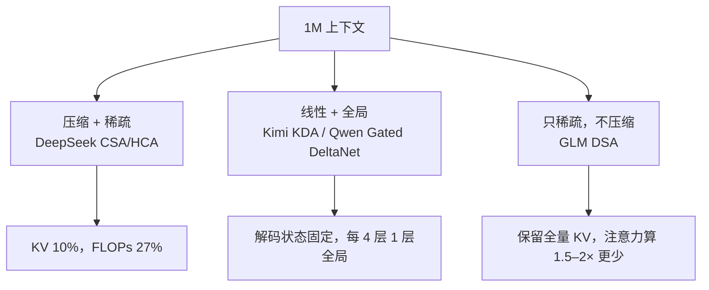

# 1M 上下文：三种做法，三种代价

1M 上下文已经不是卖点，是入场券。真正的差别在于：为了这 1M，你愿意丢多少召回。

DeepSeek V4 在 1M 下把单 token 推理 FLOPs 压到 V3.2 的 27%，KV 缓存压到 10%；Kimi K3 用 3 层线性注意力配 1 层全局注意力；GLM-5 不压 KV，只做 token 级稀疏。三家都支持百万级窗口，但省成本的位置完全不同。默认你知道 attention 的平方复杂度和 KV cache 是什么，下面直接拆账。

## 全注意力的账

1M 上下文的第一道墙不是显存容量，是 decode 带宽。每生成一个 token，模型都要把整段历史的 KV 读一遍。窗口从 128K 拉到 1M，KV 是线性增长的 8 倍；注意力计算是平方增长，只是 prefill 阶段更明显。

所以 1M 的做法只有两类：要么让每个 token 只读一部分历史，要么把历史压成更短的表示。DeepSeek、Kimi、GLM 分别走了三条路。

图 1：三种 1M 路线，省成本的位置不同。

## 压缩再稀疏：DeepSeek 的 CSA/HCA

DeepSeek V4 的注意力分两种，交替使用。

CSA 先把每 `m` 个 token 的 KV 压成一个条目：用两组 KV、两组压缩权重，沿 2m 个元素做 softmax 归一化，相邻窗口有重叠；序列长度压到 `1/m`。压缩之后再做 DSA——一个轻量 indexer 给每个 query 打分，只对 top-k 个压缩条目做注意力，核心计算用 MQA。

HCA 更狠：`m'` 远大于 `m`，不重叠，压缩完直接做稠密注意力。一个负责细粒度稀疏，一个负责粗粒度兜底。

还有几个不显眼但关键的设计：

- 每个 query 额外保留最近 `n_win` 个未压缩 KV，补上“同一个压缩块内部互相看不见”的缺口；
- 用 attention sink 稳定超长序列的 softmax；
- 只对最后 64 维施加 RoPE，其余维度不带位置；
- KV 混合存储：RoPE 维 BF16，其余 FP8，体积近乎减半；indexer 用 FP4 算。

结果是 1M 下单 token FLOPs 只有 V3.2 的 27%，KV 只有 10%。数字来自 [DeepSeek-V4 技术报告](https://arxiv.org/abs/2606.19348)，不是发布会口径。

代价也明确：压缩一定丢信息，长程精确召回要靠局部窗口和全局层补；kernel 更复杂，长序列训练的负载均衡更难，DeepSeek 为此做了两阶段上下文并行和序列重排。

## 线性层做主力：Kimi 与 Qwen

Kimi K3 的层布局是 3 层 KDA 加 1 层 Gated MLA。93 层里 69 层 KDA、24 层 MLA，最后一层固定是全局注意力。KDA 在 delta-rule 递推上加了逐通道遗忘门，块内并行、块间递推；MLA 保留全局 token-to-token 交互，同时用低秩 KV 控制显存。

还有一个细节：K3 对所有 MLA 层用了 **NoPE**，不塞位置编码，位置感主要由 KDA 的递推提供。扩上下文时不用重调 RoPE base，也不用 YaRN。这是把“位置外推”的工程负担直接吃进架构里。

Qwen3.5 是另一种排版：15 组「3 层 Gated DeltaNet + 1 层 Gated Attention」。线性层 64 个 V 头、16 个 QK 头；全局层 32 个 Q 头、2 个 KV 头。原生 262K，可扩到 1.01M。官方模型卡把话说得很直：线性层负责便宜的长程混合，全局层负责精确内容寻址。

这条路线的好处是 decode 成本平坦：线性注意力的状态大小固定，不随历史长度涨。坏处是纯线性层的精确召回弱，必须靠周期性的全局层兜底；状态感知的前缀缓存也比纯 KV 难做，Kimi 得把 KDA 状态和 MLA KV 放进同一个分页池。

两份实现分别在 [Kimi K3 报告](https://arxiv.org/abs/2607.24653) 和 [Qwen3.5 模型卡](https://huggingface.co/Qwen/Qwen3.5-397B-A17B)。

## 只稀疏不压缩：GLM 的 DSA

GLM-5 选了第三条路：KV 不压缩，用 indexer 给每个 query 选 top-k 个历史 token，只对选中的做注意力。它把 DSA 用到所有层，长序列注意力计算降 1.5–2×，上下文 200K。

GLM 报告里最有价值的是失败对比。朴素交错 SWA 在 RULER@128K 上掉 30.35 分；搜索式 SWA、GDN 线性注意力也各有 5–7 分损失；只有 DSA 被他们称为“by construction lossless”——不丢长程依赖，只是不算无关 token。

但 DSA 有个 RL 陷阱：训练引擎和推理引擎的 top-k 必须一致。GLM 发现 CUDA/TileLang 的非确定性 top-k 会让 RL 几步后熵崩塌，最后在 RL 阶段固定用确定性的 `torch.topk`，并冻结 indexer 参数。这个细节比“稀疏”两个字重要得多。

细节在 [GLM-5 技术报告](https://arxiv.org/abs/2602.15763)。

## 怎么选

| 路线 | 省在哪 | 主要代价 | 适合 |
|:--|:--|:--|:--|
| 压缩 + 稀疏 | KV 和 FLOPs 都大降 | 压缩损失、kernel 复杂 | 超长文档、代码库、离线分析 |
| 线性 + 全局 | decode 状态固定 | 精确召回弱、状态缓存难 | 高吞吐 Agent、长对话 |
| token 稀疏 | 不丢 KV，只少算 | indexer 开销、不规则访存 | 精确检索、RL 训练 |

选型前先测三件事：RULER 或 GraphWalks 的长程召回、RepoQA 的代码定位、你们真实 Agent 轨迹的 token 分布。Gemini 4 Carbon 在 GraphWalks 上拿到 96.2%，说明 1M 窗口内的可用性可以被量化；但那是它的模型，不是你的场景（[Gemini 4 Carbon 发布文](https://blog.google/innovation-and-ai/models-and-research/gemini-models/introducing-gemini-4-carbon/)）。

窗口是厂商给的，召回是自己测的。
