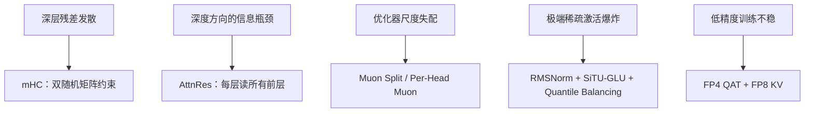

DeepSeek V4 的技术报告里，三项架构升级的第一项不是注意力，是残差连接。

这有点反直觉。大家讨论万亿模型，习惯先问多少专家、多少激活、上下文多长；真正训过的人先看 loss spike。参数堆到 1.6T，残差、优化器、路由、低精度，任何一处数值不稳，都会在几十层之后放大成不可恢复的尖峰。

这篇拆四个稳定器：mHC、AttnRes、Muon 系列、Stable LatentMoE。默认你知道标准 Transformer 的残差和 MoE 路由。

图 1：四类失败模式对应的稳定器。

## 残差不是恒等就够

标准残差是 `h + f(h)`。Hyper-Connections 把残差流扩成多通道，表达力更强，但深层堆叠容易数值发散：映射矩阵的谱范数大于 1，信号每过一层就被放大一次。

DeepSeek V4 的 mHC 做的事很数学：把残差映射矩阵 `B_l` 约束到**双随机矩阵流形**，也就是 Birkhoff 多面体。这个集合里的矩阵，行和、列和都为 1，谱范数不超过 1，所以残差变换是**非扩张**的；集合对乘法封闭，堆多深都不会把上一步的放大带进来。输入和输出变换再用 Sigmoid 约束成非负有界，避免信号相消。

一句话：残差从“固定恒等”变成“受约束的路由”，表达力和稳定性同时要。

细节在 [DeepSeek-V4 报告](https://arxiv.org/abs/2606.19348) 第 2.2 节。

## 深度方向也要注意力

Kimi K3 换了另一个角度：残差是沿深度均匀累加，每一层对前层的贡献权重一样。AttnRes 把注意力搬到深度方向——每一层可以按内容选择性地读取之前所有层的表示，而不是被动接收一个累加状态。

代价是显存和通信。全量 AttnRes 要让每层都看所有前层，开销是 `O(Ld)`；Kimi 的做法是分块：把 L 层分成 N 个 block，block 内求和，block 间做注意力，开销降到 `O(Nd)`；推理时用 online softmax 合并块间与块内结果。

K3 有 93 层，这个改动不是锦上添花。层数越深，标准残差的“信息稀释”越明显；AttnRes 让深层还能直接取到浅层的原始表示。[Kimi K3 报告](https://arxiv.org/abs/2607.24653) 把它和 KDA、Stable LatentMoE 并列为三项架构级改动。

## 优化器：Muon 不是换个名字

DeepSeek V4 把大部分模块的优化器从 AdamW 换成了 Muon，只给 embedding、预测头、mHC 静态偏置、RMSNorm 留 AdamW。Muon 带 weight decay、Nesterov，并对更新矩阵做 RMS 重缩放，复用 AdamW 的超参；因为注意力 logits 稳定，连 QK-Clip 都不用了。

GLM-5 遇到一个具体问题：MLA 的 576 维 latent KV 在 Muon 下打不过 GQA-8 的 2048 维 KV。他们的补丁是 **Muon Split**——把 up-projection 按注意力头拆成小块再做正交化，让不同头以不同尺度更新。结果 MLA 追平 GQA-8，注意力 logits 不再需要 clipping。细节在 [GLM-5 报告](https://arxiv.org/abs/2602.15763)。

Kimi 则用 **Per-Head Muon**，把正交化按头拆开，配合 93 层深栈。三家做法不同，指向同一个事实：在万亿参数下，优化器的“逐头尺度”比全局学习率更关键。

## 极端稀疏的 MoE 会激活爆炸

Kimi K3 把路由专家扩到 896 个，每个 token 激活 16 个，稀疏度 56 倍。传统 MoE 里每个被选中的专家都接收完整 `d` 维表示，专家一多，通信和权重流量就爆炸。LatentMoE 的办法是：共享专家保留全宽路径，路由专家在低秩潜空间里工作，只传一个更窄的 `z`。

但这条路有两个坑。第一，路由分支把 `W_down`、专家 FFN、`W_up` 串成接近四次连续矩阵乘，条件数很差，2.8T 规模下内部激活会爆。Kimi 在 up-projection 前加 RMSNorm，并用 SiTU-GLU 压住激活。第二，近千个专家的负载均衡，传统 aux-loss-free 的 bias 更新已经不稳；他们改用 Quantile Balancing，按分位数校准。

DeepSeek 这边则把初始若干层的 dense FFN 换成 hash 路由的 MoE，亲和度函数从 `Sigmoid` 改成 `Sqrt(Softplus)`，再叠一个轻微的 sequence-wise balance loss，防止单条序列内部极端倾斜。

## 低精度是训练问题，不只是推理问题

DeepSeek V4 的 MoE 专家权重用 FP4，其余多数参数用 FP8；FP4 量化感知训练覆盖专家权重和 indexer 的 QK 路径。当下 FP4×FP8 的峰值算力和 FP8×FP8 相同，但报告说未来硬件上理论上还能再省三分之一。

KV 缓存则是混合精度：RoPE 维保留 BF16，其余维 FP8，体积近乎减半。位置精度不能丢，内容可以压，这是一个很实用的折中。

低精度不是“训练完再量化”。专家权重和 indexer 在预训练/后训练阶段就要按 FP4 的误差特性训，否则推理时一压就掉点。

## 稳定的代价

这四类改动都不便宜：mHC 要重算和融合 kernel，AttnRes 要额外的层间通信，Muon Split 要为每个头维护正交化状态，FP4 QAT 要改训练框架。它们不会让 benchmark 立刻涨几分，但决定了 1.6T 能不能训完。

参数规模是门槛，数值稳定性是门票。
