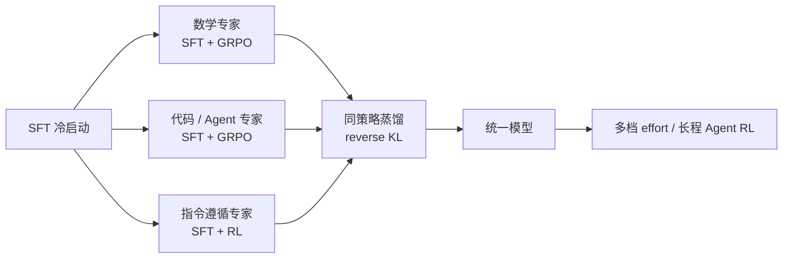

DeepSeek V4 的后训练可以压缩成两句话：每个领域先各训一个专家，再把它们蒸回一个模型。细节在 [DeepSeek-V4 技术报告](https://arxiv.org/abs/2606.19348)。

这听起来像工程捷径，其实是当前旗舰的默认做法。Kimi 用多档 effort RL 把不同推理预算的能力压进一套权重；GLM 用异步 Agent RL 加跨阶段蒸馏；OpenAI 也承认 GPT-6 大量借鉴早期模型做监督。区别只在“专家怎么分、蒸馏怎么做”。

这篇拆这条流水线，以及它带来的新问题：能力来源越来越难审计。

图 1：专家分训、同策略蒸馏、多档 effort 的先后关系。

## 多任务 RL 为什么会平均化

一个模型同时做数学、代码、Agent、写作，奖励信号互相打架。数学要长链推理，代码要可执行，Agent 要会用工具，写作要风格。用一套 reward 混训，常见结果是每项都还行、每项都不尖。

DeepSeek 的选择是分而治之：数学、代码、Agent、指令遵循各训一个专家，每个专家先 SFT，再用 GRPO 做 RL。GRPO 不训 critic，用同一 prompt 的一组采样算相对优势，适合这种“有标准答案、可以批量验证”的领域。

代价是专家之间不共享参数更新。训完四个专家，你得到四个各自很强、但互不兼容的模型。

## 蒸回一个模型

DeepSeek 的合并方式不是权重平均，是 **on-policy distillation**：统一模型当学生，自己生成轨迹；教师模型给下一个 token 的分布；学生最小化对教师的 reverse KL。

为什么强调 on-policy？因为 SFT 是在教师的轨迹上做最大似然，学生一旦走到教师没走过的状态，就会暴露偏差。让学生自己走，再由教师纠正，训练分布和推理分布才对得上。

这一步同时解决两个问题：把多个专家的能力搬进一套参数；让学生在“自己的错误”上学习，而不是只模仿正确答案。

代价是算力。学生要在线生成，教师要对每个 token 打分；蒸馏不是一次前向，是一轮一轮的 rollout。DeepSeek 的 32T 预训练之后，后训练仍然是重资产。

## effort 是训出来的，不是推理时拧出来的

Kimi K3 的版本是“多档 effort RL”：在 general、agentic、coding 三个域，多个 reasoning-effort 档位分别做 RL，再合并成一个模型。API 只暴露一个模型，却给 Low/High/Max 三档思考。细节在 [Kimi K3 报告](https://arxiv.org/abs/2607.24653)。

这解释了一个常见误解：以为 effort 是推理时临时改 temperature 或 max_tokens。真正的 effort 档位对应不同的推理行为，是训练阶段就固化下来的能力。低档不是“阉割版”，是另一条被 RL 过的策略。

DeepSeek V4 的 Think Max 也是同理：模型卡建议把窗口开到至少 384K，因为高档思考会消耗大量中间 token。effort 不是开关，是预算。

## 跨代监督：新旗舰学旧旗舰

据 [InfoQ 报道](https://www.infoq.cn/article/mKGb7ZiPRlAiFDZCWK0v)，OpenAI 研究人员在 GPT-6 发布时说，这是首个在训练中大量借鉴早期模型进行监督的版本。训练用了 10 万+ GPU，Stargate 集群。

这句话的信息量很大。过去蒸馏是“小模型学大模型”；现在新一代旗舰也学旧旗舰。新架构、新数据、新 RL 之外，能力有一部分是直接从上一代搬过来的。

好处是收敛快、少走弯路；坏处是能力来源、偏见、安全边界都可能被继承。学生模型在某个任务上很强，可能不是因为它学会了，而是因为教师会。

目前只有 OpenAI 主动披露了这一点，其他家多不说明。跨代蒸馏很可能已经是行业惯例，只是没人写进模型卡。

## 环境质量决定 RL 上限

后训练的另一半是环境。数学有标准答案，代码可以跑测试，Agent 可以看任务是否完成；这些可验证环境比 prompt 数据更难造。

GLM-5 的做法是搭一套异步 RL 基础设施：训练和推理分离，每个任务是一个微服务，注册到中央编排器；SWE、终端、搜索等 1 万+ 可验证环境联合训练，细节在 [GLM-5 报告](https://arxiv.org/abs/2602.15763)。Kimi 则把 1M 上下文的 Agent 轨迹放进可恢复的 microVM 沙箱，环境状态可以暂停、续跑。

环境也会教坏模型。[Anthropic 在 Opus 5.5 的发布文里](https://www.anthropic.com/claude-opus-5-5)明确说，有缺陷的 RL 环境是 misaligned 行为的主要来源，因此收紧环境过滤，并改进 alignment reward。[Gemini 4 Carbon](https://blog.google/innovation-and-ai/models-and-research/gemini-models/introducing-gemini-4-carbon/) 则把 Terminal-Bench 的作弊率压到 0.0%、尝试率 0.4%，把 reward hacking 当成一等指标来报。

这说明后训练的评价体系在变：不只问“跑分多少”，还问“过程是否可信”。

## 供应链问题

专家分训加蒸馏，让旗舰模型的能力变成一条供应链：预训练提供底座，领域专家提供专长，蒸馏负责集成，RL 环境负责打磨。

这条链的每一环都可以很强，也都可能出问题。专家越多，蒸馏越容易平均化；教师越强，学生越容易继承盲区；环境越复杂，reward hacking 的入口越多。

下一代模型卡如果只写 benchmark，不写能力来源，审计会越来越难。

能力来源会越来越像一份供应链清单。
