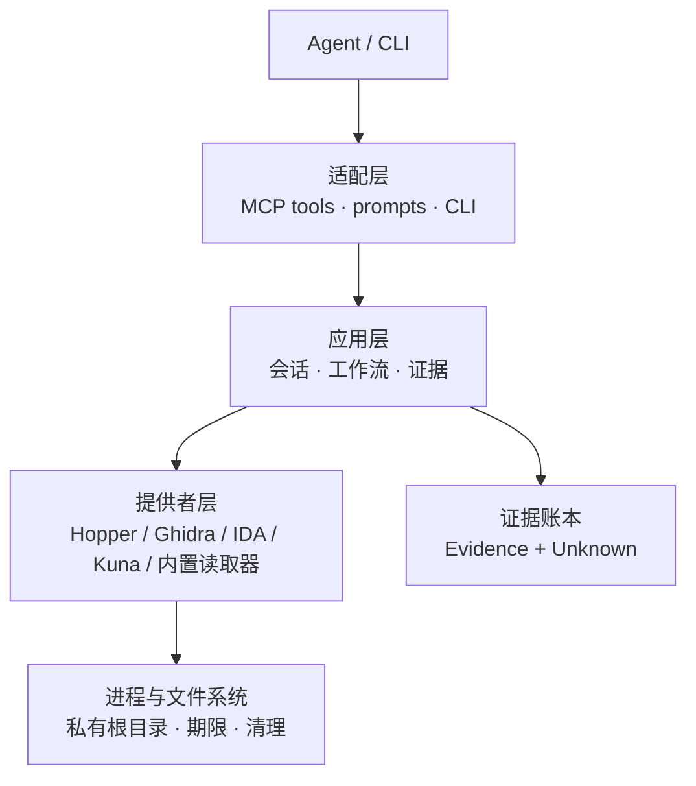

# 总纲：把逆向工程做成一条证据流水线

"这个 App 的搜索为什么第二次快？"

你把安装包丢给 Agent，它打开二进制，找到索引写入的函数，回答：第一次建了 SQLite 索引，第二次直接查缓存。听起来很合理。再追问一句：证据呢？它贴出一段反编译代码。继续问：这个函数真的在启动时被调用吗？它开始猜。

REA 想解决的是后半段。它没有发明新的反编译器，也没有训练一个更懂汇编的模型；它做的事，是把"我怎么知道"变成一等公民。

## 规模先摆在这里

以 `morluto/rea` v6.8.0（commit `93b8b82`，2026-11-02）为样本：

- `src/` 下 3,555 个 TypeScript 文件，约 95 万行，包含与实现同目录的测试。
- 源码里能数出 172 个不同的工具契约名，分属 18 个工具族。
- 安装器支持 26 个客户端，MCP 与 CLI 两条入口共用同一套应用层和组合层。
- 仓库里的技能包是 525 行 `SKILL.md` 加 7 份参考文档，合计 2,480 行。

这些数字只能说明工程量大，说明不了设计。真正值得看的是：一次工具调用从模型发出到变成一条可引用的记录，中间经过了哪些层。

## 五层，而不是一个工具箱



五个层的职责很不一样：

- **适配层**只做协议翻译：把 MCP 的 `tools/call` 变成一个带 schema 校验的请求，把结果编码成 `structuredContent`。它不解释逆向。
- **应用层**决定"这一问该用哪个工作流"，并持有会话、目标身份、证据账本和未知项注册表。
- **提供者层**把不同引擎压成同一组操作：`analyze_function`、`xrefs`、`search_strings`……Hopper 用 Python 桥，Ghidra 用 headless 脚本，IDA 接上游 MCP，Kuna 读缓存导出。
- **进程层**负责所有"脏活"：私有临时目录、进程组、启动期限、取消、SIGTERM/SIGKILL、清理失败的上报。
- **证据层**把成功观测固化成不可变记录，并把"还不知道"也登记成对象。

一次调用的路径大致是：

```text
agent → tools/call → 契约校验 → 应用服务 → provider → 引擎桥
      → 归一化结果 → Evidence 记录 → 响应预算 → structuredContent
```

注意这里没有"模型解析引擎输出"这一步。模型拿到的是已经归一化的 JSON，以及一段说明这份 JSON 从哪来、覆盖到哪、哪里不可信的元数据。

## 两条时间尺度

REA 的设计里一直有两条时间线。

**单次调用**是秒级的：打开目标、选引擎、发一条请求、等回复、落证据。所有期限、队列、取消、响应预算都为这条线服务。

**一次调查**是分钟到小时级的：提出假设、拆问题、取证、对比、记下未知项、再取证。技能文件里的路由表、检查清单、证据纪律，都是为这条线服务。

很多 Agent 工具只做了第一条线：给模型一堆函数，让它自己拼。REA 的工程量有一半花在第二条线上——让模型知道什么时候该停、什么时候该说"不知道"、什么时候该换一种证据。

## 五个不太寻常的选择

1. **引擎选择不回退。** `auto` 只有在恰好一个候选可用时才自动绑定；两个都能用就返回 `ambiguous`，让调用方选，而不是偷偷挑一个。
2. **证据不可变。** 每条 Evidence 的 ID 是内容哈希；记录一旦写入，改一个字段就对不上 ID。
3. **摘要优先。** 大结果默认只交付摘要，完整记录留在账本里，用 `parent_evidence_id` 分页取。
4. **目标内容一律不可信。** 字符串、符号、反编译代码、网页脚本都标成 `untrusted_content`；里面的"请你运行……"是数据，不是指令。
5. **技能随代码版本化。** 调查方法不是写在系统提示里，而是作为文件安装到客户端，能备份、能替换、能被 `search_guidance` 检索。

这五条分别对应后面的五篇：工具面、会话、桥、证据、预算。再往后是重建、边界和技能。

## 这个专栏怎么读

- [工具面](/notes/rea/rea-internals/rea-02-tools/)：172 个契约如何做能力协商，而不是把 schema 全塞给模型。
- [会话](/notes/rea/rea-internals/rea-03-session/)：一次 `open_binary` 如何绑定引擎，为什么一个目标只允许一个深绑定。
- [桥](/notes/rea/rea-internals/rea-04-bridge/)：Hopper 的 Python 线程和 Ghidra 的 headless 脚本如何变成可调用函数。
- [证据](/notes/rea/rea-internals/rea-05-evidence/)：`ev_` 哈希、权威等级、覆盖度和未知项注册表。
- [重建](/notes/rea/rea-internals/rea-06-reconstruction/)：从"看懂了"到"可验收"，欠账清单如何定义完成。
- [预算](/notes/rea/rea-internals/rea-07-budget/)：summary-first 不是优化，是架构。
- [边界](/notes/rea/rea-internals/rea-08-boundary/)：进程、路径、权限，以及为什么"能执行"不等于"随便执行"。
- [技能](/notes/rea/rea-internals/rea-09-skill/)：525 行 `SKILL.md` 如何把方法论写成调查协议。

如果只记一句话：REA 的输出不是"答案"，是一份带哈希、带局限、带未知项的观测记录；答案只是这份记录的一种用法。
