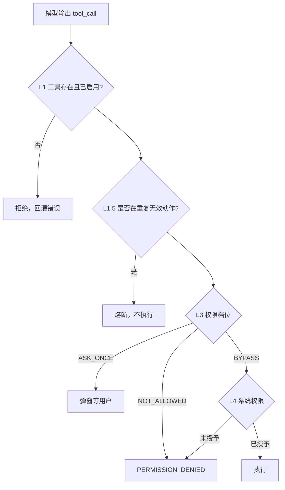

# 控制权：模型提议与宿主裁决

同一句"帮我读一下通知"，在不同状态下会有三种结局：什么都不问直接读、弹一个对话框、直接拒绝并让你去设置里开权限。

决定用哪一种的，不是模型。

## 一、没有执行权，不等于安全

第一篇说过，模型输出的是请求，执行发生在宿主。这个分工常被当成架构美学，其实它是安全模型的地基——但只说了上半句。

下半句是：**宿主一旦决定执行，就再没有第二道墙了**。它拿着真实的系统权限，做真实的动作。所以"模型没有执行权"只解决了"谁来扣扳机"，没有解决"允不允许开这一枪"。

控制权要解决的问题是后者：一个请求从模型嘴里出来，经过哪些判断才能落地。

## 二、四道关卡

完整的链路有四个判断点，各自管一件不同的事：



四层各管一件事，混在一起就会互相打架：

| 层 | 判断什么 | 失败时的表现 |
|:--|:--|:--|
| 工具存在与开关 | 这只手存不存在 | 工具根本不在清单里 |
| 循环熔断 | 是不是在重复无效动作 | 不执行，回灌明确错误 |
| 权限档位 | 这个动作准不准 | 弹窗，或直接拒绝 |
| 系统权限 | Android 给不给 | 引导去设置 |

值得单独说的是第一层和第三层的分工。工具不存在，模型连"想调"都做不到——这是**能力边界**。工具存在但被权限拦住，模型能提出请求但执行不了——这是**许可边界**。两者都表现为"做不了"，但成因完全不同，混淆了就没法排查。

## 三、默认值就是安全策略

权限分三档：`BYPASS` 直接放行，`ASK_ONCE` 每次会话问一次，`NOT_ALLOWED` 一律拒绝。

有意思的不是这三个档位，是**每一类工具的默认值**。

日历、位置、剪贴板、通讯录、相册——默认全部 `BYPASS`。理由写在源码注释里：用户既然选择装一个 Agent App，就是接受了后台访问，除非他明确把某一项降级。

但无障碍和 Shizuku 这两类默认 `NOT_ALLOWED`。原因也写得很清楚：它们能驱动别的 App、能读屏幕上的内容，风险量级和"读个天气"不是一回事，所以即使系统层已经授权，应用层仍然要用户单独点头。

这套默认值不是技术选择，是产品立场。它传达的判断是：**隐私数据可以默认开放，代操作能力必须默认关闭**。因为前者的后果是"信息被看到"，后者的后果是"别人替你在别的 App 里点了按钮"。

分类之外还有个细节：媒体播放、语音合成、闹钟、天气这些工具不碰个人数据，在权限设置页里干脆不显示。少一个开关，就少一次"这个要不要开"的犹豫。设置页里每一个选项都在消耗注意力，不重要的不该出现。

## 四、授权有粒度

`ASK_ONCE` 的名字容易误解，以为是一次性授权。实际是**一次会话**。

用户点"本会话允许"，这个工具在当前会话里就不再打扰；会话结束，授权失效。除此之外还有一个"本会话拒绝"——一旦拒绝，这个会话里不再弹同样的窗。

后面这条常被忽略，但它很关键。没有它，模型会在同一个权限上反复请求，用户每被拦一次就要点一次拒绝，体验直接崩掉。**拒绝必须被记住**，否则"询问"就变成了骚扰。

对走命令行桥接的工具，情况还要更粗一些：它们不在聊天会话的上下文里执行，拿不到会话 id，所以共用一个进程级的授权槽。这是个妥协——粒度换可达性。

## 五、没注册的工具走哪条路

权限表是一份白名单。白名单的问题是：表里没有的名字怎么办？

这里的答案是放行。未注册的工具走 `BYPASS`。

这个选择值得掰开看。放行的理由是"注册表只用于分类和展示，不是准入清单"，新加的工具不应该因为忘了登记就被默默禁用。代价是：任何绕过注册表新增的能力，默认是全开的。

这是黑名单和白名单的经典差别。白名单安全，但每加一个工具都要记得登记，漏了就是功能坏了；黑名单灵活，但漏了就是洞。

这里选了后者，因为它把"漏"的后果放在了功能侧而不是安全侧——前提是高风险能力（无障碍、Shizuku）必须显式登记为 `NOT_ALLOWED`。一旦这个前提被破坏，整个模型就反转了。

## 六、拒绝不是终点

权限被拒时，回灌给模型的不是一句"失败"，而是一个带错误码的信封：

```json
{"ok": false, "error": {"code": "PERMISSION_DENIED", "message": "…"}}
```

模型看到这个码，知道不是自己参数写错了，也不是工具坏了，而是缺授权。它该做的是告诉用户去哪里开，而不是换个参数再试一次。

这就要求拒绝的文案里带上**下一步**：哪个权限、在哪个页面、开了之后能做什么。只说"没有权限"，模型只能重复请求；说清楚路径，它才能给出有用的回复。

## 七、安全靠不给

最后回到那个常见误解：很多人以为 Agent 的安全靠系统提示词——写一段"不要删除用户文件""不要泄露隐私"，模型就会照做。

提示词是建议，不是约束。它降低的是概率，不是划定边界。

真正的边界在代码里，而且只有一种写法：**这个能力不发给它**。工具不在清单里，模型连提议的机会都没有；权限是 `NOT_ALLOWED`，提议了也执行不了；系统权限没授予，执行到一半也会被 Android 拦下。

所以评估一个 Agent 是否可信，看三件事：它的工具清单有多宽，它的默认权限有多松，它被拒绝之后的路径有多完整。

---

下一篇讲这套控制之外的部分：即使权限、工具、上下文都正常，它依然会失败。失败是常态，问题是怎么失败。
