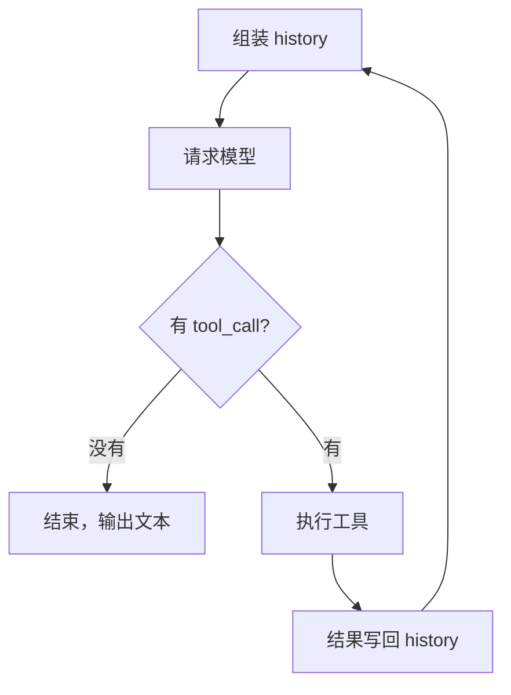

# 执行循环：单次生成如何变成多轮决策

我让它查一下明天的天气。它回了一句话：上海明天小雨，12 到 16 度。

界面上这是一问一答。但如果盯着请求看，这次交互里至少发生了两次模型调用：第一轮它没有直接回答，而是输出了一段 JSON，说"我想调用 `android-weather`，参数是纬度 31.23、经度 121.47"；宿主执行完这个工具，把结果塞回去，才有了第二轮的那句话。

这就是 Agent 和聊天机器人最容易被忽略的差别。不是模型更聪明，是它外面多了一个循环。

## 一、单次调用是一个纯函数

把一次模型调用拆到最小，它是这样一件事：

```
输入：一个 messages 数组
输出：一段文字
```

就这样。它不读文件、不发请求、不记住上一轮。服务端处理完这次请求就把上下文丢了，下一次调用你要把全部历史重新发一遍。所谓"它记得我们刚才聊了什么"，其实是客户端每次都把前文重新贴了一遍。

这个性质决定了两件事：

第一，模型不能产生副作用。它能做的只有"预测下一段文字"，哪怕这段文字长得像一条命令。

第二，模型不会自己继续。一次调用结束，它就停了。要让它接着干，必须有人再调用一次。

## 二、tool_call 是请求，不是执行

当模型"调用工具"时，它实际输出的仍然是一段文字，只不过格式被约束成了 JSON：

```json
{"name": "android-weather", "arguments": {"latitude": 31.23, "longitude": 121.47}}
```

这句话的意思是"我希望有人去查一下这个坐标的天气"，不是"我已经查到了"。模型没有执行权限，甚至不知道这个工具存不存在——它只是按照被告知的 schema 编了一段符合格式的输出。

所以一个 Agent 的最小定义，不是"会调用工具的模型"，而是**有一个东西替它执行，并且把结果还给它**。模型负责提议，宿主负责落地。

这个分工不是实现细节，是安全模型的地基。后面会看到，所有权限控制都建立在"模型只能提议"这个前提上。

## 三、循环的形状

把上面两件事接起来，循环的形状就很朴素了。下面是宿主侧的结构，去掉了重试、压缩、并发这些枝节：

```kotlin
for (turn in 0 until MAX_AGENT_TURNS) {
    val reply = model.chat(history)                 // 一轮请求
    history += reply.toAssistantMessage()           // 它说过的话先入账
    val calls = reply.toolCalls
    if (calls.isEmpty()) break                      // 唯一的正常出口
    val results = calls.map { executeTool(it) }     // 宿主执行
    history += toolResultMessage(results)           // 结果回灌，进入下一轮
}
```

对应到 Minis 的实现，是 `ChatViewModel.runAgentLoopBody` 里那个 `for (turn in 0 until turnCap)`。源码注释写得很直白：

> Every iteration is one model request; turn>0 means the previous turn's tool results were judged worth sending on.

翻成中文：每一次迭代就是一次模型请求；`turn > 0` 意味着上一轮的工具结果值得继续往下发。



注意图里那条回到起点的箭头。它不是"重试"，是**带着新信息重新决策**。这是整个机制里唯一有意义的部分：每一轮循环，模型看到的输入都比上一轮多了一条真实世界的反馈。

## 四、结果是怎么回去的

这里有两个不显然的设计，值得单独说。

**第一，工具结果是以"用户"身份回灌的。**

在 Minis 的实现里，工具执行完会拼成一条消息追加到历史：

```kotlin
LLMMessage(
    role = LLMMessage.Role.USER,
    content = "",
    contentParts = resultParts,
)
```

角色是 `USER`，不是 `TOOL`。原因是大多数模型 API 的对话协议只有 user 和 assistant 两种角色，没有"工具"这个位置。于是宿主把结果伪装成用户说的话，模型在下一轮看到的就是：

> 用户：［工具结果］上海 明天 小雨 12–16℃

这不是偷懒，是协议限制下的唯一解法。它也解释了一个常见现象：模型有时候会把工具结果当成"用户提供的信息"来引用，因为它确实就是这么看到的。

**第二，同一批工具会并发执行，但不是无脑并发。**

一轮里模型可能同时要求调三个工具。宿主用信号量控制并发数（Minis 里是 10），但在这之上还有一条顺序规则：**同一批里，读操作要等写操作完成**。

源码里记着这个 bug 的原始形态：一次调用里同时有 `shell_execute`（生成 `q-1.png`）和 `read_image q-1.png`，两个任务同时起跑，读图的那个经常读到上一个版本，或者文件还没生成就报错。修法是给同一批调用排序——写者先跑，读者等它结束再拿槽位。

这条规则说明，工具调用的"并行"不是调度问题，是语义问题。模型把两个调用放在同一批，只代表它们可以一起提，不代表它们互不依赖。
## 五、出口不止一个

如果只写 `if (calls.isEmpty()) break`，这个循环能用，但会以几种难看的方式挂掉。实际实现里至少要处理五类终止：

| 出口 | 触发条件 | 处理方式 |
|:--|:--|:--|
| 正常结束 | 这一轮没有 tool_call | 输出文本，落库 |
| 轮次上限 | 跑满 500 轮 | 兜底终止，标记异常 |
| 循环熔断 | 同一动作反复重复 | 不执行，回灌错误 |
| 上下文耗尽 | 输入装不下 | 停下，但保留可恢复状态 |
| 用户中断 | 点停止 | 取消协程，保留已产出的内容 |

轮次上限那个数字是 500。它不是拍脑袋定的正常路径，源码里写得很清楚：`MAX_AGENT_TURNS` 是 `ToolLoopDetector` 之后的最后一道保险，不是回合的正常结束方式。正常对话跑两三轮到十几轮就结束了，能跑到 500 轮说明别的地方已经失效。

这里有个值得学的细节：实现里专门用了一个 `loopExitedNormally` 标志，区分"正常跑完"和"撞上限停下"。少了这个标志，每一条普通回复的结尾都会被贴上一句"已达最大轮次"的假错误——因为从循环结构上看，两种结束长得一模一样，都是跳出 `for`。

一个循环写到能用，靠的是 `break`；写到可靠，靠的是**每种退出都有明确的状态**。否则用户看到的就是一个永远转圈的思考中。

## 六、代价

循环不是免费的，代价有两个，而且都随时间线性增长。

**延迟。** 一次工具调用至少两轮模型请求。查一次天气，用户等的是两次推理的时间，不是一次。

**上下文。** 每一轮都要把全部历史重发一遍，而工具结果通常很长——一次 `rg` 的输出可能几千字，一个文件读进来上万字。第二轮请求的体积不是第一轮的两倍，可能是十倍。到第十轮，模型面对的是一个被工具输出塞满的窗口。

所以真实的 Agent 实现里，一半的复杂度不在循环本身，在"怎么让这个循环跑得下去"：裁剪历史、压缩摘要、溢出守卫、结果截断。这些是后面要讲的内容。

## 七、为什么智能来自循环

回到开头那个问题：为什么同样的模型，套上循环之后就像换了一个？

因为单轮生成做的事情是**在已有知识里找答案**。模型知道的就到它训练截止那天为止，它不知道你机器上装了什么、这个文件里写了什么、刚才那条命令有没有成功。

循环改变的是信息条件。每一轮工具结果回来，模型看到的输入里就多了一条它事先不可能知道的事实。它不是在"想得更久"，是在**看到了更多**。

这也给了一个判断 Agent 好坏的标准：不看它一轮能说多少，看它一轮能带回多少有效信息。工具设计得窄、结果给得糊、失败没有信号，循环转十圈也只是在原地打转。

模型是引擎，循环是传动轴。引擎再强，传动轴不转，车也不动。

---

下一篇讲传动轴的另一头：模型凭什么知道有哪些工具可用，以及一段 JSON 是怎么变成一个真实动作的。
