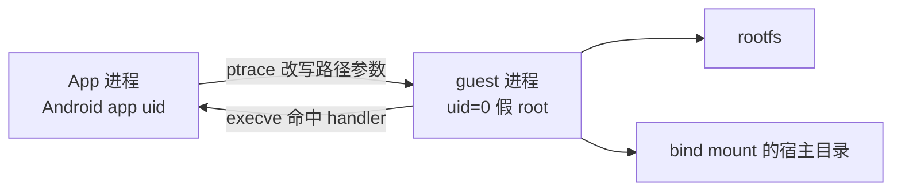

# 沙箱：工具的执行位置与隔离

工具执行需要真实的文件系统与进程环境。隔离由 PRoot 提供：伪造 root、路径与部分系统调用，但它不是安全边界。

## 工具需要一个真实的地方

前面几篇一直在说「宿主执行工具」。但执行不等于调用一个函数——很多工具要做的事，必须落在一片真实的文件系统上，跑在一个真实的进程里。

`shell_execute` 是最典型的例子。它要能装包、编译、跑脚本、读文件，这意味着它需要一整套 Linux 用户空间：shell、coreutils、包管理器、动态链接库。

问题是，它跑在 Android 手机上。没有 root，没有容器，没有命名空间。

## PRoot 与容器的区别

容器靠内核的 namespace 和 cgroup 做隔离，前提是有 root，或者至少 user namespace 可用。Android 的 app 进程两样都没有。

PRoot 走的是另一条路：**ptrace**。

它跟踪子进程的每一次系统调用，把涉及路径的参数改写成 rootfs 里的位置，再把结果翻译回去。对 guest 程序来说，自己就在一个以 rootfs 为根的 Linux 里；对内核来说，跑的还是同一个 app uid 下的普通进程。

所以它不是隔离，是**翻译**。这个区别决定后面所有的事。

同一个进程，两套路径视图。`open("/etc/passwd")` 被翻译成 `open("<rootfs>/etc/passwd")`，程序拿到的文件描述符是真的，只是它指向的位置被换过了。

## 要伪造的三样东西

一个正常的 Linux 程序，启动时会确认三件事：我是谁、文件在哪、网络通不通。沙箱要让它对这三件事都得到满意的答案。

**身份。** PRoot 用 `-0` 参数让 guest 以为自己以 uid 0 运行。这是假 root：`id` 会打印 `uid=0(root)`，但内核层面权限一点没多，`kill` 不了别的进程，`mount` 照样失败。

**文件系统。** 用 `-r <rootfs>` 把某个目录设为根，再把宿主机的 `/dev`、`/proc`、`/sys` 绑进去，最后按需挂载用户的目录。程序看到的 `/` 是 rootfs，看到的 `/var/minis` 是宿主的一个真实路径。

**网络。** 这一层最难。Android 的 `untrusted_app` 域不允许创建 `NETLINK_ROUTE` 套接字，而几乎所有需要枚举网卡的程序启动时都会建一个。Go 写的工具会直接报 `netlinkrib: permission denied` 然后退出。

沙箱的解法是让 proot 自己应答这个请求，返回一个**空的接口列表**。

这是对 guest 程序说的一个蓄意的谎。源码注释写得很直白：这个行为是「故意骗它」，因为「没有任何网卡」至少能让那些只需要确认「有没有网卡」的调用方启动起来。

## 硬链接的覆盖缺口

有些裂缝不是设计出来的，是被现实逼出来的。

Alpine 的包管理器装 busybox 系列工具时，用的是硬链接：`ar`、`ld`、`nm`、`strip` 全部链到同一个 busybox 二进制上。

但 Android 的 `/data` 分区的挂载方式，不允许 app uid 跨目录建硬链接。内核直接返回 `EPERM`。

结果是：在这个沙箱里，`apk add binutils` 必然失败，报「权限不足」，而用户根本不知道自己哪里没权限。

修法是 proot 的一个扩展参数 `--link2symlink`：拦截 `link()` 系统调用，改建一个符号链接。对包管理器来说，符号链接和硬链接在使用上没有区别，装包就过了。

这条补丁揭示了一个事实：**沙箱不是把 Linux 搬进来，是把 Linux 骗进来**。每遇到一个宿主不允许的行为，就找一个语义近似但能通过的替代品。

## 威胁模型

这一点必须说清楚，因为「沙箱」这个词容易给人错误的安全感。

真正的安全边界不在 PRoot 里，而在三个更硬的地方：

| 边界 | 由谁提供 |
|:--|:--|
| 进程身份 | Android 的 app uid，PRoot 改不了 |
| 文件访问 | SELinux 策略，读不到别的应用数据 |
| 危险动作 | 应用的权限闸门，前面讲过 |

PRoot 能防的是**误操作**：`rm -rf /` 删的是 rootfs，不是手机系统；装错包搞坏的是沙箱，不是宿主。

它防不了恶意代码。一段真正想逃出去的程序，可以绕开被翻译的路径，直接调用未被拦截的系统调用。所以不能把「跑在沙箱里」当成「可以随便跑」。

## 隔离成本

用翻译换兼容，要付三笔账。

**性能。** 每一次系统调用都要被 ptrace 拦一次，再决定改写还是放行。启动一个 shell、装一个包、跑一次 `find`，开销都是可感知的。这解释了为什么沙箱里的编译总是比真机慢。

**兼容性。** 每一处「善意的谎言」都是一个潜在的坑。谎报网卡数量，某些程序会崩；谎报 root 身份，某些程序会尝试真正的特权操作然后失败；`/proc` 被 SELinux 限制，`top` 遍历进程表时会直接打不开文件。

**可观测性。** 出问题时，错误经常发生在翻译层，而不是业务代码。用户看到的是「权限不足」，实际原因可能是 SELinux、proot 参数、rootfs 权限三者之一。

所以成熟的做法是给这些裂缝补上转译：`top` 坏了，就装一个用 `ps` 实现的替代品；某个目录读不到，就在日志里明确写清楚是 bind mount 还是 SELinux。

## 沙箱的本质

回到开头那个 `ping`。

它挂住，是因为 ICMP 在这个网络环境里被阻断，包发出去没有回应，程序就一直等。这不是沙箱的缺陷，是「外面那层现实」漏进了沙箱——沙箱没有承诺网络一定通，它只是没有伪造一个假的通。

这大概是理解沙箱最好的角度：**它承诺的是一个自洽的环境，不是一个完整的环境**。文件系统自洽，路径翻译一致，装了包就能用；但它不承诺网络可达、不承诺硬件存在、不承诺权限齐全。

这些缺口会在某些时刻突然暴露，而 Agent 需要知道怎么在里面干活——这正是它和普通程序最大的不同：普通程序假定环境正确，Agent 要在环境不正确时想办法。

## 小结

- PRoot 用 ptrace 改路径参数，是翻译不是隔离；Android 上没有 root 和 namespace，这是能走通的那条路。
- 身份、文件系统、网络三样都要伪造，每一处谎言都是裂缝：空网卡列表、硬链接转符号链接、/proc 受限。
- 它防误操作，不防恶意；承诺的是自洽环境，不是完整环境——网络不通、权限缺一半都是常态。

---

开头那个 `ping` 会一直挂到超时。它提醒的是同一件事：Agent 干活的地方从来不是理想环境——记不全、连不通、权限缺一半。

所谓工程，就是在这样的条件下把事办成。

而那些留下的痕迹，还要等下一次打开时重新拼起来。
