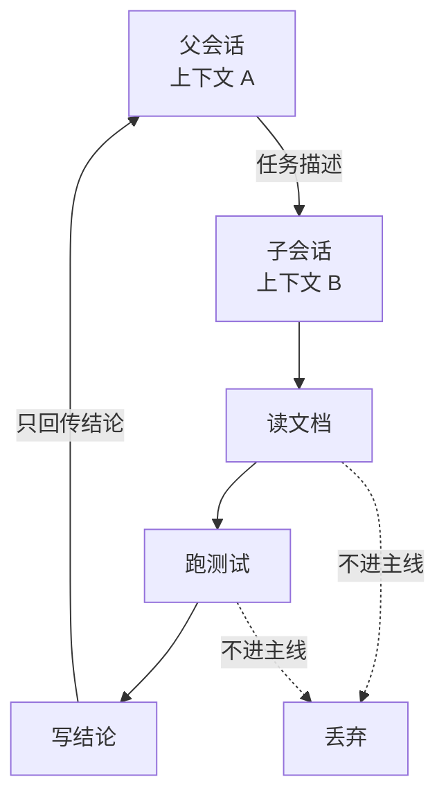

# 任务分片：上下文隔离的代价

任务装不下的通常不是计算量，而是上下文。分片用子 agent 隔离上下文，代价是信息不回传。

## 装不下的不是任务，是过程

一个人做这件事，笔记本上留三行结论就够了，中间读过的每一页都可以忘。

模型不行。它没有「笔记本」，只有一份每轮重发的对话记录。读过的每一页都在里面，而且是全文。三个库的文档读完，窗口里塞满的是过程，结论反而没地方放。

所以分片要解决的不是「任务太大」，是**中间产物太占地方**。真正需要的输出可能只有五百字，为了得到它，上下文里堆了几万字。

## 子 Agent 是上下文隔离，不是并行

常见的误解是把多 Agent 理解成「多叫几个 AI 一起干」。

真实机制要朴素得多：父会话调用一个工具，把任务描述交给它；子 Agent 在自己的会话里跑一个完整的循环——有自己的历史、自己的工具调用、自己的上下文预算；跑完之后，只把结果交回来。

关键在那两条虚线。子会话里读过的每一个文件、跑过的每一条命令，都不会进入父会话的上下文。主线只多了一条消息：任务完成了，结果是这个。

这不是并行计算，是**内存分页**。把一大块中间状态放到另一个地址空间，用完只带一个返回值回来。

## 回传什么，决定了隔离是否成立

如果子 Agent 把全过程都交回来，隔离就白做了。

所以回传的内容是被裁剪过的。以 Minis 的实现为例，一次子任务结束后保留的摘要包括：调用过哪些工具（一行一个，带标题）、跑了多少轮、进出各多少 token、以及它最新写出的一段文本。

注意最后一项的措辞：**最新的一段文本**，不是全部输出。子 Agent 中间写过的草稿、失败的尝试、被推翻的方案，都不回传。

这个取舍有个副作用：主模型看不到子 Agent 是怎么得出这个结论的。它只能选择信，或者再派一次任务去验证。**信任成本是隔离的必然代价**。

## 花名册本身也要占地方

还有一个容易忽略的成本：子 Agent 的存在本身要写进父会话的系统提示。

每个可委派的子 Agent 都要有一份说明：叫什么、能干什么。这份说明每一轮都要发给模型，否则它不知道可以委派给谁。

所以这不是「想加多少加多少」的功能。实现里给了硬上限：最多 10 个，名字 40 字符，描述 200 字符。算下来大约 800 token 的固定开销，每轮都付。

源码注释里把这个逻辑说得很清楚：这些数字不是防呆，而是因为花名册每轮都注入，**数量和描述长度就是每请求的固定成本**；把输入限死，就不需要在运行时再弹一个 token 超标的警告。

这条经验可以推广：**任何常驻上下文的东西，都要有硬上限**。工具描述、系统提示、记忆条目、子 Agent 花名册，全是同一类东西。靠「提醒用户别写太长」解决不了，只能靠结构上限。

## 代价：它不知道你知道什么

分片之后，最常出的问题不是能力不够，是**信息不对称**。

子 agent 看不到父会话的历史。用户对主模型说过的「我们用 Kotlin，不用 Java」，不会自动传给子 agent；子 agent 拿到的是任务描述。

所以委派的质量，几乎完全取决于任务描述的质量：

| 写法 | 结果 |
|:--|:--|
| 「看看这三个库哪个好」 | 它按自己的标准选，可能完全不符合你的约束 |
| 「在 Kotlin/Android 项目里比较 A、B、C，重点看启动耗时和包体积，给出结论和理由」 | 大概率可用 |

这也是为什么很多 Agent 框架强调「交接文档」：不是流程需要，是**上下文不共享，只能靠文字传递**。

## 分叉是另一种隔离

除了委派，还有一种更轻的分片：分叉。

从当前会话的某个点分出一个新会话，它继承此前的全部历史，然后独立生长。主线不受影响，分支可以随便试。

两种隔离的区别很实在：

| | 委派子 Agent | 会话分叉 |
|:--|:--|:--|
| 继承历史 | 不继承，只给任务描述 | 继承到分叉点 |
| 回传内容 | 只有结论 | 完整对话 |
| 适合 | 独立、边界清楚的任务 | 探索性、需要前文的工作 |
| 成本 | 一次额外上下文 | 一份完整副本 |

委派是「派一个人去办事」，分叉是「我先去另一条时间线试试」。前者省上下文，后者省解释成本。

## 什么时候不该拆

分片不是免费的。多一个 Agent，就多一次模型调用、多一份上下文、多一层信息损耗。

有三种情况不值得拆：

**任务能用一段话描述清楚，但做起来只要两三步。** 拆出去的开销比直接做还大。

**子任务之间需要频繁交换中间结果。** 隔离了就没法交换，只能来回传话，越传越失真。

**结论依赖大量隐含前提。** 你脑子里那些「不用说的常识」，子 Agent 一条都不知道。

反过来，判断该不该拆有个简单标准：**这个子任务能不能用一段话完整描述，并且不需要看主线历史就能干**。能，就适合派出去；不能，就留在主线里。

## 小结

多 Agent 不是架构上的炫耀，是上下文预算逼出来的分页策略。

它用「看不见过程」换「装得下任务」，用「信任成本」换「窗口空间」。这笔交易划不划算，取决于任务本身能不能被切干净。