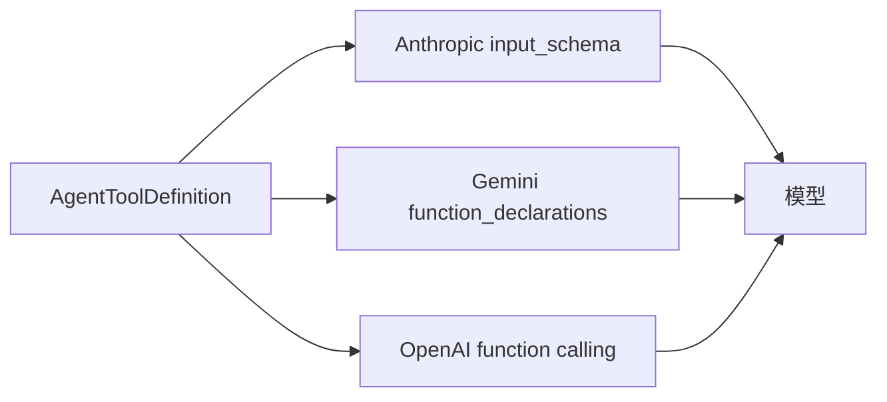

# 工具调用：意图、schema 与副作用

我问它："这个文件里还有几处 TODO？"

它没有读文件。它输出的是一段 JSON：

```json
{"name": "shell_execute", "arguments": {"command": "rg -c TODO src/main.kt"}}
```

这段话不是答案，是一个请求。真正读文件、数行数、把结果变成文字的，是另一个进程。

循环转起来之后，下一个问题是：**模型凭什么知道有哪些工具可用，一段 JSON 又是怎么变成真实动作的。**

## 一、模型看到的是一份说明书

模型对工具的全部认知，来自调用请求里附带的一段定义。它长这样：

```json
{
  "name": "shell_execute",
  "description": "在 Linux 沙箱中执行 shell 命令……",
  "parameters": {
    "type": "object",
    "properties": {
      "command": {"type": "string", "description": "要执行的命令"}
    },
    "required": ["command"]
  }
}
```

三个字段各司其职。`name` 是调用时的标识；`description` 决定它什么时候会想起这个工具；`parameters` 约束它怎么填参数。

这里最容易误解的是 `description`。它不是给人看的注释，是**模型判断"该不该用这个工具"的唯一依据**。写得含糊，模型就会在该用的时候不用、不该用的时候乱用；写得清楚，很多所谓的"提示词调优"根本不需要。

参数的 schema 描述的是意图，不是实现。`city: string` 背后的实现可能是查数据库、调 API 或者读本地缓存，模型完全不需要知道。它只需要知道"这里要填一个城市名"。

## 二、一份定义，三种投影

不同厂商的工具调用协议长得不一样。Anthropic 叫 `input_schema`，Gemini 叫 `function_declarations`，OpenAI 叫 `function calling`，字段位置和大小写都有出入。

如果每个工具各写三份，改一个参数要改三处，迟早对不上。所以宿主里维护的是**一份与厂商无关的中间表示**：

```kotlin
data class AgentToolDefinition(
    val name: String,
    val description: String,
    val parameters: Map<String, AgentToolParam>,
    val required: List<String> = emptyList(),
)
```

再由三个适配方法投影出去：`toAnthropicJson()`、`toGeminiJson()`、`toOpenAIJson()`。



这个设计不复杂，但它决定了一件事：**工具的能力是宿主定义的，不是厂商定义的**。换模型只需要换投影，工具本身不动。

## 三、执行发生在另一个世界

模型输出 JSON 之后，宿主要做四件事：找到同名工具、解析参数、真正执行、把结果包成一条消息。

真正执行的那一端，和模型隔着一整个世界。以 `shell_execute` 为例，参数 `command` 最终会变成沙箱里的一个进程；以 `android-weather` 为例，它会变成一次系统 API 调用。模型对这一切一无所知，它只知道自己发了一个请求，然后收到了一段文字。

这带来一个必须提前想清楚的问题：**副作用能不能撤销**。

读文件、查天气、搜索网页，这些没有副作用，失败了重试就是。写文件、发消息、改日历、执行命令，这些有副作用，重试可能造成二次伤害。所以工具在设计上天然分成两类，宿主对它们的容错策略也应该不同——这条线会在后面几篇反复出现。

## 四、开关装在读取处，不装在界面上

工具不是全都该一直开着。浏览器、子 Agent、向用户提问，这三类能力在设置里各有开关。

实现上有个细节值得单独说。开关的判断没有放在设置页，而是放在**每一次读取工具列表的地方**：

```kotlin
enum class AgentToolSwitch(val key: String, val defaultValue: Boolean) {
    BROWSER("agent.tools.browser.enabled", true),
    AGENTS("agent.tools.agents.enabled", true),
    USER_ASK(UserAskSettingsSpec.ENABLED_KEY, UserAskSettingsSpec.DEFAULT_ENABLED),
}
```

源码注释的原话是：这个闸门装在读取处，而不是只装在界面上；构建 schema、循环分发、CLI 桥接三条路径都会调用 `isToolEnabled`，所以一个存下来的 `true` 没法绕过设置页把能力重新打开。

这句话翻译过来是一条通用原则：**权限判断要放在数据出口，不要放在用户界面**。界面只是若干条路径中的一条，任何一条没走界面的路径都会成为漏洞。

## 五、模型不总是听话

schema 是一份契约，但签约方经常违约。

最常见的是参数类型漂移。某些 OpenAI 兼容网关会把嵌套数组塞成字符串：本该是 `[{...}]`，实际发来的是 `"[{...}]"`。宿主如果直接按数组解析就崩，如果直接拒绝又太苛刻——模型的意思其实很清楚。

Minis 的处理是在执行前做一次强制转换：按 schema 声明逐个检查，能转的就转，转不了的保持原样交给工具自己报错。源码里记着触发频率：某类模型七次调用里有五次发的是字符串。

比类型漂移更危险的是**参数被截断**。模型生成到一半撞上输出上限，JSON 在字符串中间断了。自动补一个引号能让 JSON 合法，但补出来的内容不是模型想写的。所以实现里有一条硬规则：

> 写操作（`file_write`、`file_edit`）遇到截断参数一律拒绝执行，只读工具和 shell 继续放行。

理由是源码注释里那句话：对写操作来说，半个文件落盘是**静默的数据损坏**，比不写更糟。

这条规则的价值不在具体实现，在于它承认了一件事：**修复模型的错误，要看错误的后果**。能无损修复的就修，修了会有副作用的就停。一刀切地"尽力修复"或者"一律拒绝"都不对。

## 六、工具面就是能力面

回到最初的问题：为什么同一个模型，在这个 App 里能改文件、查天气、读通知，在网页版里只能聊天？

因为工具清单不一样。模型本身没有变化，变的是它手里有什么。

这带来一个判断：**评估一个 Agent，先看它的工具清单，再看它的模型**。清单决定了能力的上界——没有 `shell_execute`，它永远只能描述命令而不能执行；没有写文件的工具，它永远只能建议你改哪一行。

但工具不是越多越好。每加一个工具，就多一份说明书要占用上下文，多一条路径要写权限，多一种副作用要想清楚怎么撤销。更麻烦的是"万能工具"：一个 `shell_execute` 几乎能做所有事，也几乎能造成所有后果。它省掉了设计十个专用工具的成本，也把判断风险的责任全部推给了权限层。

所以工具设计真正的取舍不是"多与少"，是**接口的窄与宽**。窄接口安全但笨，宽接口灵活但危险，中间那条线画在哪里，取决于你愿意为每个动作承担多少后果。

---

下一篇往回收一步：这些东西每多一轮，就要重新塞进模型一次。上下文是怎么被塞满的，又是怎么被腾出来的。
