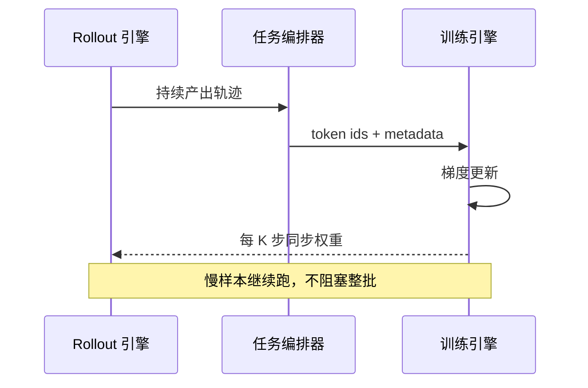

# Agent RL 慢在最慢的那条轨迹

GLM-5 的 Agent RL 里，一条慢轨迹能拖住整个同步点。细节在 [GLM-5 报告](https://arxiv.org/abs/2602.15763)。

这不是比喻。同步 RL 每一轮都要等所有 rollout 跑完才能更新；Agent 任务的轨迹长度差异极大，有的几十步结束，有的一直在调工具、读文件、重试。最慢的那条决定了整批的墙钟时间，其余 GPU 空转。

这篇拆系统层：异步解耦、TITO、双侧重要性采样、环境编排、可恢复沙箱。默认你知道 PPO/GRPO 的基本形状。

图 1：训练与推理解耦后，慢样本不再阻塞整批。

## 同步 RL 的空转

Agent 轨迹有两个特点：长，且长度分布长尾。

长意味着一次 rollout 可能几十万 token；长尾意味着多数样本很快结束，少数样本跑很久。同步训练每轮都等最后那一小撮，GPU 利用率会被拖到很低。GLM-5 的报告直接把这叫“severe GPU idle time”。

更麻烦的是多轮工具调用。每次工具返回都要重新 prefill，长前缀反复计算；如果 prefill 和 decode 混在同一批资源上，一个重 prefill 就可能打断正在 decode 的样本，尾延迟进一步恶化。

## 把训练和推理拆开

GLM-5 的做法是彻底异步：

- 训练引擎和推理引擎放在不同 GPU 上；
- 推理引擎持续生成轨迹，攒够阈值就送给训练引擎；
- 训练引擎更新参数，每 K 步把新权重推回推理引擎；
- 每次推回权重后重置优化器，避免新旧策略的动量混在一起。

这带来一个直接后果：一条轨迹在生成过程中，模型可能已经更新了好几次。行为策略和当前策略不一致，off-policy 偏差变成常态。

GLM 用两个机制控制它。

第一是 **TITO（Token-in-Token-out）**：actor 直接吐 token id 和 metadata，不做文本往返、不重新分词。这样“采样到的动作”和“训练优化的动作”逐 token 对齐，不会因为 detokenize/retokenize 产生细微偏移。

第二是 **Direct Double-sided Importance Sampling**：不保存所有历史 checkpoint，而是对 rollout 的 log-prob 做 token 级双侧裁剪 `[1-ε_l, 1+ε_h]`，直接控制 off-policy 偏差。版本差超过阈值 τ 的轨迹直接丢弃，避免太旧的样本把策略拉回去。

## 环境也要编排

Agent RL 不是“一个模型加一个 reward 函数”。SWE、终端、搜索，每个任务的工具集、回放逻辑、验证器都不一样。

GLM-5 的做法是 **Multi-Task Rollout Orchestrator**：每个任务实现成独立微服务，注册到中央编排器；编排器控制每个任务的采样比例和生成速度，把不同框架的轨迹统一成 message-list，再交给训练侧。报告说这套东西支持 1k+ 并发 rollout，能动态调任务采样比。

环境规模是 1 万+ 可验证的 SWE、终端、多跳搜索任务。这个数字比任何 RL 算法都更难复制：造环境、维护验证器、防止 reward hacking，都是长期工程。

## 1M 轨迹的麻烦

Kimi K3 把 Agent RL 推到 1M 上下文。细节在 [Kimi K3 报告](https://arxiv.org/abs/2607.24653)。一条轨迹几百次工具调用、几百万累计 token，不可能一次跑完。

他们的系统做了几件事：

- **partial rollouts**：轨迹可以分段生成，不必等整条结束；
- **外部 KV cache 保留**：推理引擎换实例，缓存还能接上；
- **自适应限流**：根据负载调节生成速度，避免长尾把队列拖垮；
- **可恢复 microVM 沙箱**：环境状态可以暂停、恢复，工具执行到一半也能续；
- 训练与推理 co-located，按尾延迟调度。

这里还有一个架构层的耦合：KDA 线性注意力的状态大小固定，但前缀缓存不能只存 KV，还要存递推状态。Kimi 把 KDA 状态和 MLA KV 放进同一个分页池，才能在 prefill/decode 分离、不同 TP 度数的节点之间迁移时，把重排放在传输路径上，GPU 侧不做额外搬运。

模型架构决定了服务系统能怎么做，服务系统又反过来限制 RL 能训多长。

## 代价

异步 RL 不是免费的：

- 策略滞后变成超参。K 步同步一次、τ 设多大、IS 裁剪区间多宽，都会影响稳定性和样本效率；
- 轨迹版本管理复杂。要记录每条样本用了哪些模型版本，才能判断它有多旧；
- 复现难。系统层的调度、限流、缓存策略，论文里往往只写一段，真正跑起来全靠工程。

但方向很清楚：Agent 能力的上限，越来越由“能跑多长、能并行多少环境、尾延迟多低”决定，而不是由某个 loss 项决定。

算法论文给你 loss，系统论文给你吞吐；Agent RL 两个都要。
