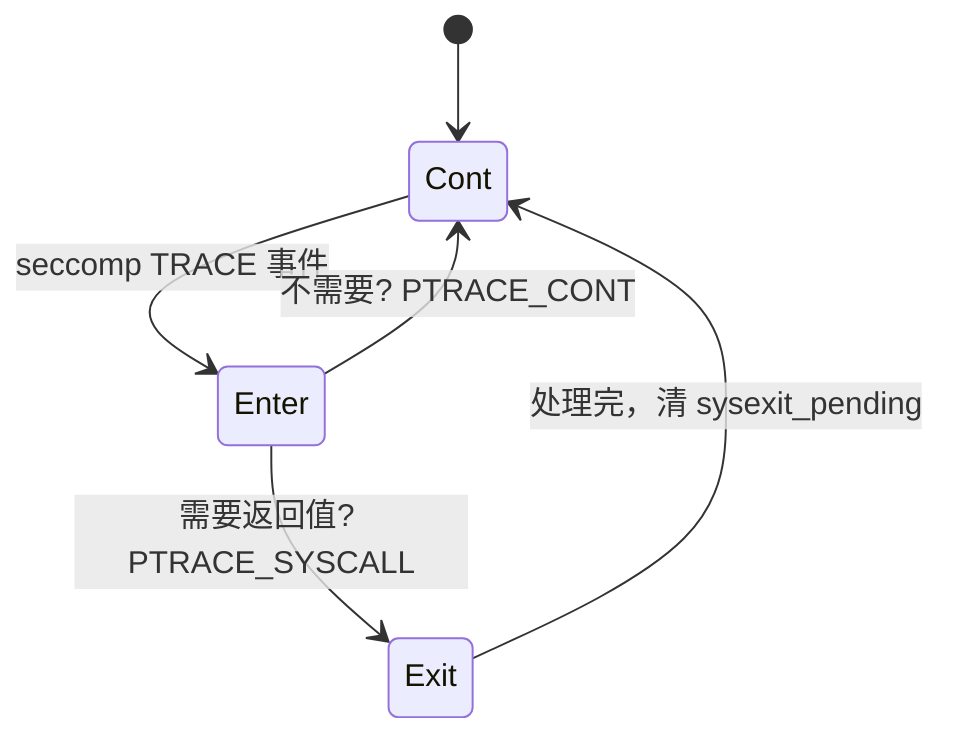

# 事件循环：waitpid 与进程树管理

PRoot 的 tracer 是单线程事件循环：waitpid 收取事件，在系统调用入口与出口改写参数，再让 tracee 继续。

## 主循环

```c
/* src/tracee/event.c:350 */
while (1) {
    free_terminated_tracees();

    pid = waitpid(-1, &tracee_status, __WALL);
    if (pid < 0) {
        if (errno != ECHILD) { /* 真错误 */ }
        break;                       /* 没有 tracee 了，退出 */
    }

    tracee = get_tracee(NULL, pid, true);
    tracee->running = false;

    status = notify_extensions(tracee, NEW_STATUS, tracee_status, 0);
    if (status != 0)
        continue;                    /* 扩展接管了这个事件 */

    if (tracee->as_ptracee.ptracer != NULL) {
        bool keep_stopped = handle_ptracee_event(tracee, tracee_status);
        if (keep_stopped)
            continue;                /* 这个 tracee 自己也是别人的 tracer */
    }

    signal = handle_tracee_event(tracee, tracee_status);
    (void) restart_tracee(tracee, signal);
}
```

四个要点：

- `__WALL` 让 `waitpid` 也能收到 clone 出来的线程，否则多线程程序会漏事件。
- `free_terminated_tracees()` 被放在循环开头：源码注释说这是**唯一安全**的释放点，因为其它时刻可能正持有指向 tracee 的指针。
- `NEW_STATUS` 是扩展的第一个介入点，返回非 0 就连 PRoot 自己的处理都跳过。
- `handle_tracee_event()` 返回的 `signal` 会被原样交给 `restart_tracee()`，也就是说**信号是转发给 tracee 的**，不是 tracer 自己处理。

## 信号策略：除了六种，全部忽略

`event_loop()` 开头对 `0..SIGRTMAX` 逐个 `sigaction`：

```c
case SIGQUIT: case SIGILL: case SIGABRT: case SIGFPE: case SIGSEGV:
    signal_action.sa_sigaction = kill_all_tracees2;   /* 自己崩了，带走所有人 */
    break;
case SIGUSR1: case SIGUSR2:
    signal_action.sa_sigaction = print_talloc_hierarchy;  /* 打印内存树，调试用 */
    break;
case SIGCHLD: case SIGCONT: case SIGSTOP:
case SIGTSTP: case SIGTTIN: case SIGTTOU:
    continue;                                          /* 保持默认 */
default:
    signal_action.sa_sigaction = (void *) SIG_IGN;      /* 其余全部忽略 */
    break;
```

为什么敢忽略绝大多数信号？因为 PRoot 是 tracer，Ctrl-C 产生的 SIGINT 会先送到前台进程组里的 tracee；tracee 停在 syscall-stop 时，PRoot 再把信号原样注入。tracer 自己被 SIGINT 打死，才是真正的灾难——所有 tracee 会变成孤儿。

而 SIGSEGV/SIGABRT 这类必须处理：PRoot 若带着一树 tracee 异常退出，那些进程会永远停在 `ptrace-stop` 里。

## 停在哪里：ptrace options

第一次看到 `SIGTRAP` 时，PRoot 给 tracee 设置：

```c
PTRACE_O_TRACESYSGOOD | PTRACE_O_TRACEFORK | PTRACE_O_TRACEVFORK |
PTRACE_O_TRACEVFORKDONE | PTRACE_O_TRACEEXEC | PTRACE_O_TRACECLONE |
PTRACE_O_TRACEEXIT
```

- `TRACESYSGOOD`：让系统调用停变成 `SIGTRAP | 0x80`，和真正的断点/单步 SIGTRAP 区分开。
- 四个 `TRACE*FORK/CLONE`：新进程自动进入追踪，PRoot 在 `new_child()` 里用 `PTRACE_GETEVENTMSG` 取到 pid，创建对应的 `Tracee` 对象。
- `TRACEEXEC`：execve 成功后地址空间已被换掉，PRoot 需要这个事件来写装载脚本（第五篇）。

`new_child()` 里有个容易被忽略的细节：`clone(CLONE_VM)` 的父子共享地址空间，所以 heap 用 `talloc_reference()` 共享；不带 `CLONE_VM` 才 `memdup` 一份。`seccomp`、`restart_how`、`no_new_privs` 也一并继承。

## 加速：只拦 86 个系统调用

默认的 `PTRACE_SYSCALL` 是「每个系统调用停两次」——进入一次、返回一次。一次 `ls` 就要停上百次，这个开销无法接受。

PRoot 的做法是装一个 seccomp-BPF，让内核替它做初筛。过滤器结构很朴素：先校验 `arch`，再逐条比较 `nr`，命中就返回 `SECCOMP_RET_TRACE`，否则 `SECCOMP_RET_ALLOW`。

```c
/* src/syscall/seccomp.c:113 */
BPF_JUMP(BPF_JMP + BPF_JEQ + BPF_K, syscall, 0, 1),
BPF_STMT(BPF_RET + BPF_K, SECCOMP_RET_TRACE + flag)
```

名单在 `proot_sysnums[]` 里，v5.5.0 是 **86 条**：所有带路径的（`openat`、`statx`、`readlinkat`、`execve`…）、所有改身份的（`setuid`、`chown`…）、以及 `ptrace`、`uname`、`brk` 这些需要特殊处理的。不在名单里的系统调用，内核直接放行，PRoot 根本不会被唤醒。

`flag` 位里的 `FILTER_SYSEXIT` 决定要不要看返回值：

```c
if ((flags & FILTER_SYSEXIT) == 0) {
    tracee->restart_how = PTRACE_CONT;   /* 入口处理完就走，不等返回 */
    translate_syscall(tracee);
    ...
}
```

只有那些「必须改返回值」的系统调用才带这个标记——`getcwd`、`readlink`、`accept`、`wait4`、`execve` 等。其余的在入口改完参数就放行。

## 状态机：restart_how 与 sysexit_pending

seccomp 模式下有个麻烦：内核只在**入口**通知你，但你有时又需要**出口**。PRoot 用两个字段解决：

```c
/* src/tracee/event.c:421 */
if (tracee->seccomp == ENABLED && !tracee->sysexit_pending)
    tracee->restart_how = PTRACE_CONT;
else
    tracee->restart_how = PTRACE_SYSCALL;
```

当入口阶段发现这个系统调用需要看返回值，就主动把 `restart_how` 改成 `PTRACE_SYSCALL` 并置 `sysexit_pending`，于是内核会在返回时再停一次；出口处理完清掉标记，恢复 `PTRACE_CONT`。



还有一个 `DISABLING` 状态：当 tracee 自己调用 `ptrace`（比如在里面跑 gdb），PRoot 必须让它看到**每一个**系统调用，seccomp 加速会立刻关掉——"we can't assume what are the syscalls its tracer is interested with"。

## 代价

到这里可以算一笔账：没有 seccomp 时，每次系统调用两次上下文切换；有了 seccomp，只有 86 类系统调用会停，且大部分只停一次。PRoot 的性能问题从来不是「每个系统调用都停」，而是「路径类系统调用停两次，且每次都要在 tracee 内存里读写字符串」。

## 小结

- 整个 tracer 是一个单线程的 `waitpid(-1, __WALL)` 循环；`__WALL` 是它能同时看到线程和进程的原因。
- 停点由 ptrace options 决定，`SIGTRAP | 0x80` 把系统调用停和普通信号分开。
- seccomp-BPF 把 86 类系统调用挑出来上报，其余直接放行；`restart_how` 与 `sysexit_pending` 负责在「只停入口」和「必须看返回值」之间切换。