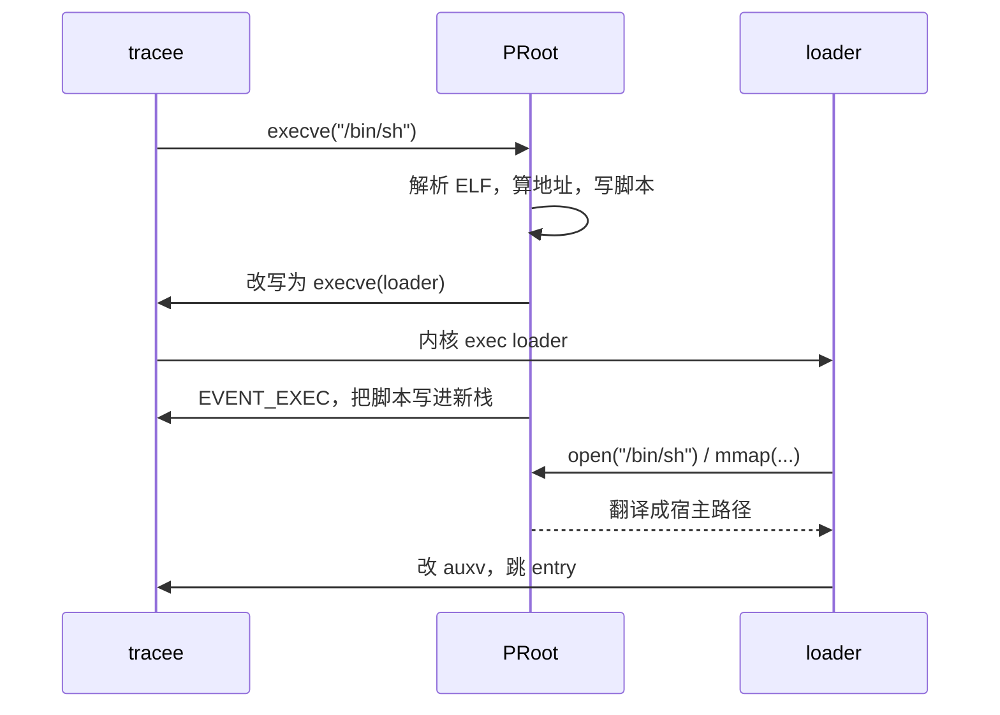

# execve：为什么 PRoot 要自带一个 ELF loader

前四篇里，PRoot 做的都是「改参数、改返回值」。但 `execve` 是个硬边界：内核要打开 ELF、读 `PT_INTERP`、映射动态链接器——这些全在内核里完成，PRoot 插不进手。更要命的是，ELF 文件里写的 `PT_INTERP` 是 guest 路径（`/lib/ld-linux-x86-64.so.2`），宿主上根本不存在，内核会直接 `ENOENT`。

PRoot 的解法很硬：**不让你执行那个程序，先执行我。**

## 换头

```c
/* src/execve/enter.c:621 */
status = extract_load_info(tracee, tracee->load_info);
if (tracee->load_info->interp != NULL) {
    status = extract_load_info(tracee, tracee->load_info->interp);
    if (tracee->load_info->interp->interp != NULL)
        return -EINVAL;          /* 解释器不能再有解释器 */
}

compute_load_addresses(tracee);

/* Execute the loader instead of the program.  */
loader_path = get_loader_path(tracee);
status = set_sysarg_path(tracee, loader_path, SYSARG_1);
```

`get_loader_path()` 把内置的 loader 写到临时文件、`chmod 0755`、返回路径。所谓「内置」，是真的二进制内嵌：

```c
/* src/execve/enter.c:509 */
extern unsigned char WEAK _binary_loader_elf_start[];
...
status2 = write(fd, start, size);
fchmod(fd, S_IRUSR | S_IXUSR | ...);
```

这个 ELF 在构建时就被 `objcopy` 成目标文件链进了 `proot`：

```make
# src/GNUmakefile:289
LOADER_CFLAGS  += -fPIC -ffreestanding
LOADER_LDFLAGS += -static -nostdlib -Wl,-Ttext=$(LOADER_ADDRESS)
```

`-nostdlib` + 固定 `-Ttext`：loader 没有 libc，不能调用任何需要重定位的函数，入口就是 `_start`。

## loader 干的活：读一份脚本

loader 不解析 ELF，它只解释一份 20 来行的「装载脚本」。脚本是一个 `LoadStatement` 数组，每条指令一个动作：

```c
/* src/loader/loader.c:119 */
void _start(void *cursor)
{
    while (1) {
        LoadStatement *stmt = cursor;
        switch (stmt->action) {
        case LOAD_ACTION_OPEN:
            fd = SYSCALL(OPENAT, 4, AT_FDCWD,
                         stmt->open.string_address, O_RDONLY, 0);
            break;

        case LOAD_ACTION_MMAP_FILE:
            status = SYSCALL(MMAP, 6, stmt->mmap.addr, stmt->mmap.length,
                             stmt->mmap.prot, MAP_PRIVATE | MAP_FIXED,
                             fd, stmt->mmap.offset >> MMAP_OFFSET_SHIFT);
            if (status != stmt->mmap.addr) FATAL();
            if (stmt->mmap.clear_length != 0)
                clear(...);      /* 手动清 BSS 尾巴 */
            break;
        ...
        case LOAD_ACTION_START:
            /* 改 auxv，然后跳过去 */
        }
    }
}
```

动作只有六种：`OPEN`、`OPEN_NEXT`（先关掉上一个文件再打开下一个）、`MMAP_FILE`、`MMAP_ANON`、`MAKE_STACK_EXEC`、`START`。

**脚本里的路径是 guest 路径。** 这一点很容易看漏：`load_info->user_path` 被写进字符串区，而不是解析时用的 `host_path`。因为 loader 自己也是被 PRoot 追踪的 tracee，它 `open("/bin/sh")` 时照样会被翻译一次。PRoot 在这里没有走捷径，而是复用了整条路径翻译链——少一条特例，少一类 bug。

## 脚本怎么进到新进程

`execve` 之后地址空间已经换了，PRoot 只剩一次 `PTRACE_EVENT_EXEC` 的机会。它在新的栈顶之下写脚本，然后把两个寄存器指过去：

```c
/* src/execve/exit.c:374 */
poke_reg(tracee, STACK_POINTER, stack_pointer - buffer_size);
poke_reg(tracee, USERARG_1, stack_pointer - buffer_size);

/* 必须先把 SP 降下来再写，否则内核可能不允许栈指针之下的缺页 */
status = write_data(tracee, stack_pointer - buffer_size, buffer, buffer_size);
```

栈指针之下的空间是「未映射但可增长」的，先写会触发缺页失败，所以顺序不能反——注释里专门写了这一句。

`USERARG_1` 就是 x86-64 的 `%rdi` / arm64 的 `%x0`，loader 的 `_start(void *cursor)` 从这里拿到脚本地址。arm64 的汇编注释写得很清楚：进程启动时唯一保证有定义的寄存器只有 PC、SP 和 x0（rtld_fini）。

## 为什么要控制装载地址

```c
/* src/execve/enter.c:355 */
static void compute_load_addresses(Tracee *tracee)
{
    if (IS_POSITION_INDENPENDANT(tracee->load_info->elf_header)
        && tracee->load_info->mappings[0].addr == 0) {
        add_load_base(tracee->load_info, EXEC_PIC_ADDRESS);   /* 0x3000000000 */
    }
    if (tracee->load_info->interp == NULL)
        return;
    if (IS_POSITION_INDENPENDANT(tracee->load_info->interp->elf_header)
        && tracee->load_info->interp->mappings[0].addr == 0) {
        add_load_base(tracee->load_info->interp, INTERP_PIC_ADDRESS); /* 0x3f00000000 */
    }
}
```

PIE 程序在内核手里会被随机放置，PRoot 无法预知 `AT_PHDR`、`AT_BASE` 该填什么。所以它干脆自己指定地址：可执行体在 `0x3000000000`，解释器在 `0x3f00000000`（x86-64 与 arm64 相同，32 位不同）。

代价写在下一行注释里：

```c
/* TODO: support for ASLR. */
```

**PRoot 下没有 ASLR。** 所有 PIE 程序都落在同一个固定地址，这是设计取舍，不是 bug。

## 修 auxv：最后的谎言

loader 映射完，跳到 `entry_point` 之前，要改新栈上的 auxiliary vector：

```c
case AT_PHDR:   cursor2[1] = stmt->start.at_phdr;   break;
case AT_PHENT:  cursor2[1] = stmt->start.at_phent;  break;
case AT_PHNUM:  cursor2[1] = stmt->start.at_phnum;  break;
case AT_ENTRY:  cursor2[1] = stmt->start.at_entry;  break;
case AT_BASE:   cursor2[1] = at_base;               break;
case AT_EXECFN:cursor2[1] = at_execfn;              break;
```

这些值在脚本的 `START` 指令里带着——`AT_PHDR` 是程序头表在内存里的地址（`phoff + mappings[0].addr`），`AT_BASE` 是解释器的装载基址，`AT_EXECFN` 指向原始 `argv[0]` 字符串。

`AT_EXECFN` 是块老伤。内核写进去的是「被 exec 的那个文件」，也就是 loader；不修的话，程序读 `/proc/self/auxv` 会以为自己在跑 `prootedXXXX`。v5.5.0 的 changelog 里专门记了这条修复：

> `AT_EXECFN` naming the loader instead of the traced program, which broke Rust coreutils (uutils) under PRoot.

同一份修好的 auxv 还会被写进临时文件，`bind` 到 `/proc/<pid>/auxv` 上——因为 `PTRACE_EVENT_EXEC` 之后内核那份是错的，而程序（比如 QEMU user-mode）真的会去读。`src/syscall/enter.c` 里还有个 `redirect_own_auxv()`，专门对付「程序自己 `open("/proc/self/auxv")`」这条路。

## 两层 tracee

loader 不是「PRoot 的一部分」，它是一个普通的被追踪进程：

- 它的 `open`/`mmap` 走完整的翻译链；
- 如果它自己又被 gdb 之类的 ptracer 盯着，PRoot 还要把它的系统调用上报给那一位（`LOAD_ACTION_START_TRACED` 就是为此准备的）；
- 所以 PRoot 用 `ignore_loader_syscalls` 把 loader 的内部动作对上层 ptracer 隐藏掉。

一次 `execve` 的完整时序：



下一篇离开「程序怎么跑起来」，看 PRoot 怎么把「撒谎」做成可插拔的机制。
