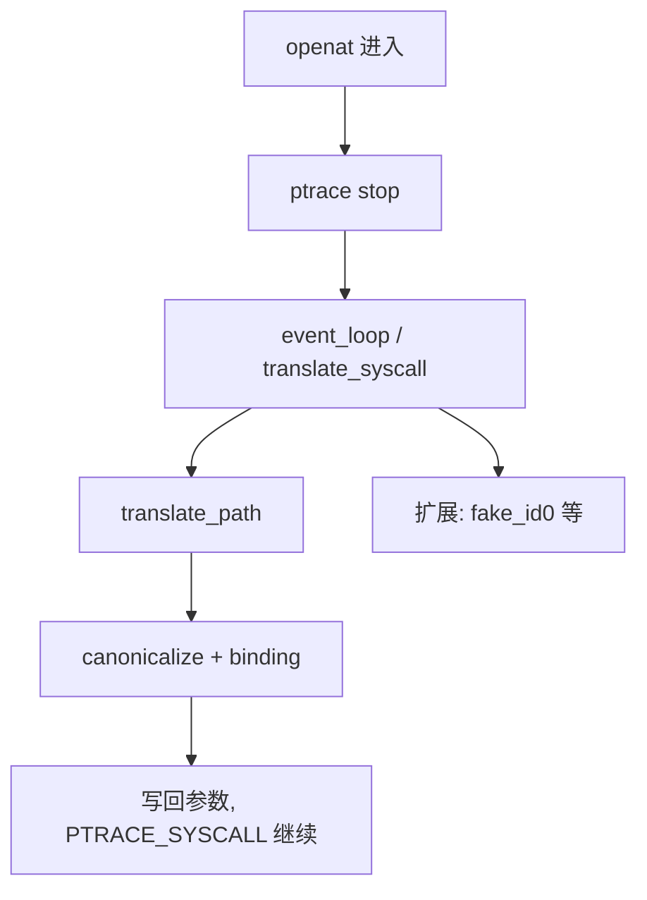

# PRoot 是什么：把 chroot 做进 ptrace 里

PRoot 的官方定义只有一句话：chroot、`mount --bind` 和 binfmt_misc 的用户态实现。它不需要 root，不需要内核模块，不需要 user namespace，甚至不需要容器运行时——只要一个 `ptrace(2)`。代价同样干脆：被它接管的进程，每走一步都要停下来问它一次。

这是「PRoot 解剖」的第一篇，先看它不做什么、做什么，以及一条 `proot -r` 命令背后到底发生了什么。

## 它不做什么

三件事值得先讲清楚，因为它们决定了后面所有设计的形状。

**它不创建命名空间。** 在 guest 里读 `/proc/self/ns/mnt`，看到的是宿主的值。PRoot 不调用 `unshare`，也不打算调用。

**它不虚拟化内核。** guest 里的 `uname` 返回宿主内核版本（除非用 `-k` 让 kompat 扩展改口），设备、网络、时钟、调度全是宿主的。官方手册写得很直白：guest kernel is never involved。

**它不装载任何内核机制。** 没有 overlayfs，没有 `pivot_root`，没有 mount namespace；`-b` 不是真的 bind mount，`-r` 也不是真的 chroot。

它只做一件事：在系统调用的入口和出口，**改写参数与返回值**。路径换成宿主路径，uid 换成 0，`uname` 换成旧版本——全部发生在寄存器和进程内存这一层。

## 一次启动

`main()` 在 `src/cli/cli.c` 里解析完参数，走到 `launch_process()`：

```c
/* src/tracee/event.c:59 */
pid = fork();
switch (pid) {
case 0:                       /* child */
    ptrace(PTRACE_TRACEME, 0, NULL, NULL);
    kill(getpid(), SIGSTOP);  /* 与事件循环握手 */
    if (getenv("PROOT_NO_SECCOMP") == NULL)
        enable_syscall_filtering(tracee);
    execvp(tracee->exe, argv);
```

三个细节：

1. `PTRACE_TRACEME` 在 `execvp` **之前**，所以接下来的 execve 本身就会被拦下——PRoot 需要这一次拦截来接管装载（第五篇）。
2. `SIGSTOP` 不是多余的。源码注释写得很明白：不这么做，tracer 只会看到下一个 execve 的「返回」，从而错过 interpreter/runner。
3. `enable_syscall_filtering()` 在 exec 前安装 seccomp-BPF，只把 PRoot 关心的系统调用上报给它（第二篇）。

父进程拿到 pid 后进入 `event_loop()`：一个 `while (1)` 加 `waitpid(-1, &status, __WALL)`。没有线程池，没有 epoll，整个 tracer 是单线程的。

## 地形图

源码 99 个 `.c/.h`、约 2.6 万行，其中核心 1.97 万行、内置扩展 5,858 行。

| 目录 | 行数 | 职责 |
|:--|--:|:--|
| `tracee/` | 3,103 | 进程对象、寄存器、内存读写、事件循环 |
| `syscall/` | 5,120 | enter/exit 改写、seccomp 过滤、系统调用链、堆 |
| `path/` | 3,053 | 规范化、绑定表、glue、`/proc` 仿真 |
| `execve/` | 3,517 | ELF 解析、装载脚本、auxv |
| `ptrace/` | 1,378 | 把 tracee 的 ptrace 调用模拟掉 |
| `loader/` | 713 | 内置的无 libc ELF loader |
| `cli/` | 2,380 | 命令行、配置、启动 |
| `extension/` | 6,252 | 事件总线 + fake_id0 / link2symlink / kompat / portmap / care |

一次路径系统调用的完整链路：



## 它靠什么成立

三句话：

- **路径是伪造的**：guest 的 `/` 只是宿主上的一个目录，所有绝对路径在进入内核前被替换。
- **系统调用是真的**：替换后的路径交给宿主内核执行，权限检查、文件系统语义都是真的。
- **控制流是借来的**：ptrace 的 stop 是唯一介入点，所以 PRoot 的能力边界，等于「能在 stop 点上改什么」。

第二句决定了 PRoot 不是安全边界，第三句决定了它的性能天花板。两点都在最后一篇展开。

## 版本与读法

本专栏基于 `proot-me/proot` v5.5.0（commit `25dc6a3`，2026-10-02）。文中代码都标了文件与行号，便于对照；示例输出来自用同一份源码在本机 aarch64 上编译的 `proot`。

下一篇从那个 `waitpid` 开始。
