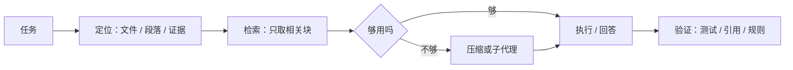

一个编码 Agent 跑到第 30 轮，输入已经 71K token。

按 3K 系统提示、10K 检索结果、每轮新增 2K 算，这不是极端案例，是默认配置。窗口是 1M，账单却按每轮重送来。

这篇只回答一个问题：同一个任务，把上下文从 4K 加到 1M，质量和 token 到底怎么变。

## 先把账算清

第 t 轮的输入是 `系统提示 + 检索结果 + 前 t-1 轮历史`。累计输入：

```
I = T(S + R) + Δ·T(T-1)/2
```

`S` 是系统提示，`R` 是每轮检索，`Δ` 是每轮新增历史，`T` 是轮数。后半项是二次的，轮数翻倍，历史部分约翻四倍。

按 `S=3K`、`R=10K`、`Δ=2K`、`T=30`：

| 策略 | 累计输入 | 相对全量 |
|---|---:|---:|
| 全量历史 | 1.26M | 100% |
| 上限 32K | 860K | 68% |
| 上限 16K | 501K | 40% |
| 只带检索，不带历史 | 390K | 31% |

输出另加 30K，占比不大。真正的账单在输入。

前缀缓存能打折，但只打钱，不打注意力预算。缓存命中后，模型仍然要在长上下文里找信息，context rot 不会因为 billing 便宜就消失。

## 质量不是跟着长度涨

NoLiMa 测了 13 个声称支持 128K 以上的模型。任务没有字面匹配，必须靠潜在关联找证据。到 32K，11 个模型跌到短上下文基线的一半以下；GPT-4o 从 99.3% 掉到 69.7%。[NoLiMa](https://arxiv.org/abs/2502.05167)

RULER 的结果类似：17 个模型都声称至少 32K，只有一半在 32K 还能维持满意表现。[RULER](https://arxiv.org/abs/2404.06654)

Context Rot 把变量控得更干净：任务简单、证据就在文内，只改变输入长度。18 个模型仍然随长度退化，而且退化不均匀。[Context Rot](https://research.trychroma.com/context-rot)

Anthropic 把这叫“注意力预算”：每多一个 token，都在消耗模型分给其他 token 的注意力。好的上下文工程不是找更多 token，是找**最小的高信号 token 集**。[Anthropic](https://www.anthropic.com/engineering/effective-context-engineering-for-ai-agents)

所以质量曲线不是单调上升，是倒 U：短了缺证据，过了有效上下文开始被噪声稀释。

## 长会话吃掉多数 token

生产数据比 benchmark 更直接。

CompactionBench 分析了 GitHub Copilot 的 13.5M 个 Agent 会话、3.2M 用户、760M 次调用。只有 7.8% 的会话触发压缩，但它们吃掉 44.2% 的 token。[CompactionBench](https://arxiv.org/abs/2605.23296)

这不是“平均上下文”的问题，是尾部问题。优化普通的 20 轮会话，省不下多少；优化那 7.8% 的长会话，账单才会动。

同一份研究里，APEC 把压缩放到后台异步做，保持前缀缓存稳定：总成本降 25.4%，执行时间降 9.6%，任务质量还升了。压缩不是“省钱的降级”，做得好是双赢。

## 局部上下文，可能更便宜也更准

Agentless 在 SWE-bench Lite 上没用复杂 Agent，而是“定位 → 修复 → 验证”三段式：32.00% 解决率，按 2024 年 API 价格约 $0.70/实例，高于当时多数开源 Agent，成本更低。[Agentless](https://arxiv.org/abs/2407.01489)

它说明的不是“Agent 没用”，而是：**先把上下文缩小到相关文件，再让模型动手。**

Anthropic 的子代理是同一个逻辑：子代理可以烧几万 token 探索，回传主代理的只有 1,000–2,000 token 摘要。贵的探索被隔离，贵的结论不进入主上下文。



图 1：先缩小上下文，再让模型执行。

## 怎么选

| 任务 | 4K | 16K–32K | 128K–1M | 建议 |
|---|---|---|---|---|
| 多跳文档 QA | 缺证据 | 检索命中时最佳 | 边际收益低，干扰变多 | 16K 检索 + 引用 |
| 仓库修 bug | 只能改单文件 | 跨文件定位够用 | 贵，且被无关代码稀释 | 先定位，再给 16K 局部 |
| 多轮工具任务 | 忘规则、忘状态 | 压缩后可维持 | 不解决“该记什么” | 规则固定 + 压缩 + 外部记忆 |

四条实操规则：

1. 先测有效召回，再买大窗口。RULER/NoLiMa 的分数比“支持 1M”有用。
2. 上下文按预算管理：设 token 上限，超了就压缩或丢工具结果，不要让它自然增长。
3. 优化尾部会话：统计 p95 token，而不是只看均值。
4. 单文档、一次性、证据分散的任务，才值得把 128K–1M 一次塞满。

窗口是厂商给的，预算是自己花的。把上下文当容量，账单会教你做人；把它当预算，才知道该花在哪。
