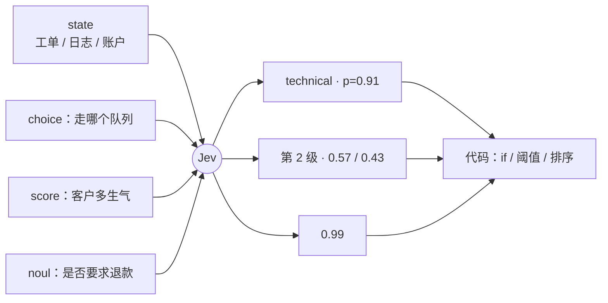
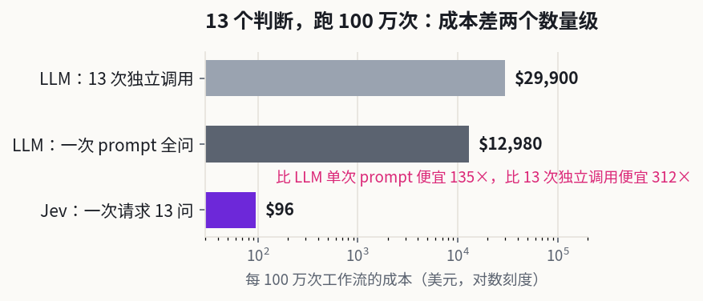
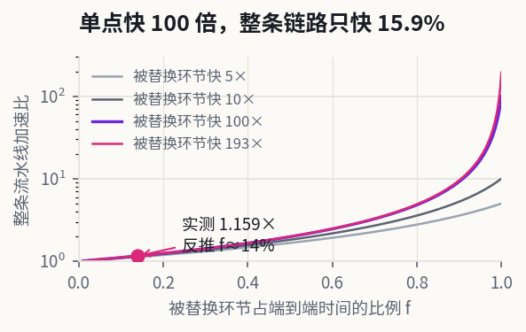
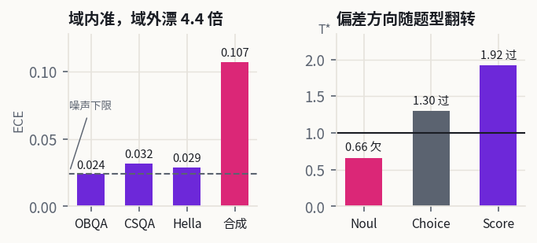
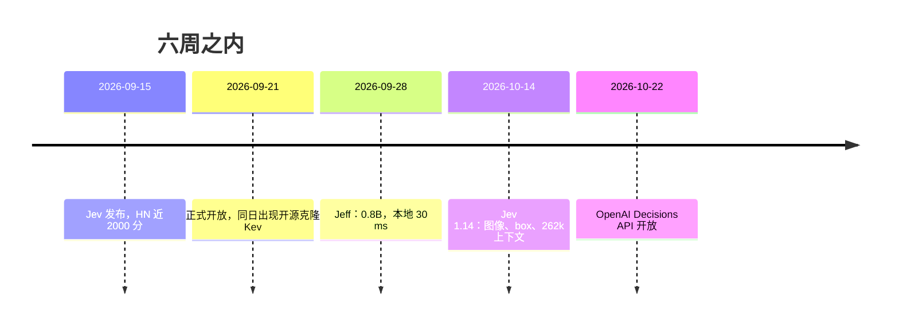
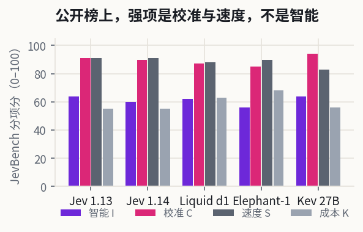
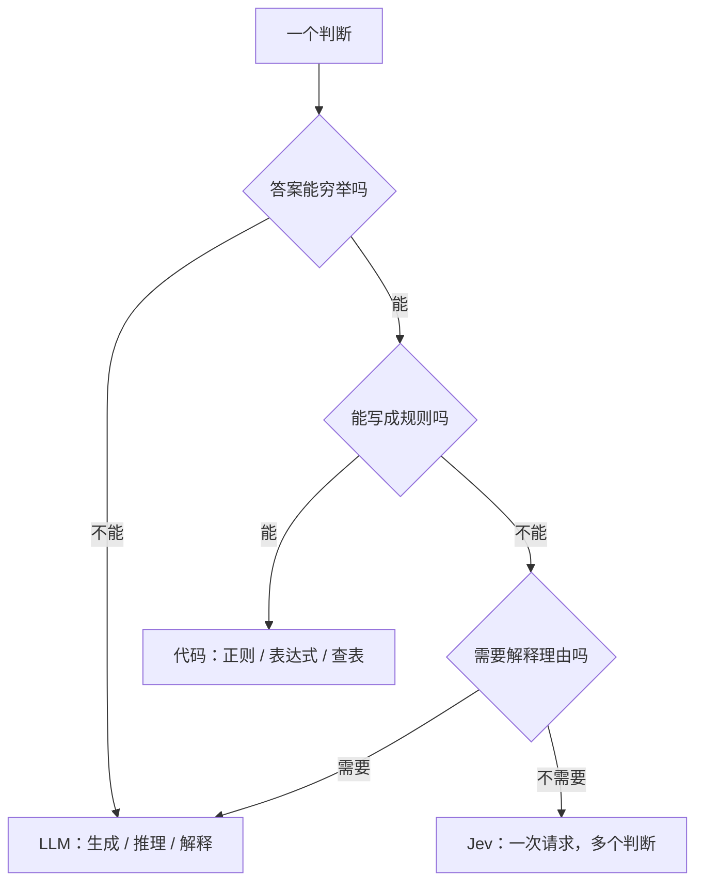

# Jev 拆解：把决策从生成里拆出来

2026 年 9 月 15 日，旧金山的 TypeSafe 放出 Jev：给它一段程序状态，它还你一个带概率的类型化选择，没有一个字的解释。一个多月后，这家公司以 75 亿美元估值拿到 8.7 亿美元 A 轮，a16z 领投。

官方的数字是两个数量级：同等判断力下快 193 倍、便宜 444 倍，而且"不会幻觉"。

这篇不谈发布会。要回答的是三个问题：它的快和便宜到底从哪省出来；哪些数字是实验室口径；你系统里的哪个 `if` 值得换成它。读者画像：写过 LLM 分类、也在生产里被结构化输出坑过的后端或平台工程师。

## 一、交付物是一个契约

Jev 的请求只有两块：`state` 和 `questions`。`state` 是任意文本或 JSON——工单、日志、账户记录；`questions` 是若干带类型的问题，答案空间必须由你事先穷举。



四种原语里，三种是给 `if` 用的：`choice` 从固定选项里选一个，`score` 落在有序档位上，`noul` 返回一个"是"的概率。第四种 `box` 是 1.14 版本才开放的实验类型，返回一个边界框，用来试探决策之外的形态。

调用的形状是这样的：

```js
const res = await client.systemOne({
  state: ticket,
  questions: {
    department: choice("Which team should handle this", {
      billing: "Payment or subscription issues",
      technical: "Bugs or integration problems",
      sales: "Pricing or account questions",
    }),
    frustration: score("How frustrated the customer appears", [
      "Calm, just stating facts",
      "Frustrated but civil",
      "Very angry, strong language",
    ]),
    is_urgent: noul("The message conveys urgency or time-sensitivity"),
  },
});

res.answers.department.choice; // "technical"
res.answers.is_urgent.noul;    // 0.99
```

注意 `0.99` 这个值：它不是从一段 JSON 里解析出来的，是模型对"是"这个选项的输出。这是它和"让 LLM 输出结构化 JSON"最根本的区别——**类型安全不是校验出来的，是构造出来的**。

官方没有公开架构。但从行为能反推出四条硬约束：

1. 输出只能落在你给的选项上，所以最后一层是打分头，不是词表；
2. 同一请求里的问题互不构成上下文，每个问题只条件于 `state`；
3. 增加问题几乎不增加延迟，所以问题是并行算的，不是串行生成的；
4. 输出 token 不计费，所以没有自回归解码这一步。

社区里有人用 25 行 Python 读选项字母的 logprob，复现了大致效果。这既是原理演示，也提前说明了后面的事：这道门槛没有想象中高。

## 二、便宜来自批处理，不是来自单价

先把账算清楚。Jev 的定价是输入每百万 token 0.042 美元，输出免费。也就是说，一次请求的成本只取决于 `state` 有多长、问题有多少，和你让它答多少东西无关。

按 13 个判断、`state` 1500 token、每问 60 token 估：

- Jev 一次请求：2280 token × \$0.042/M ≈ **\$0.000096**，跑 100 万次工作流约 **\$96**；
- 前沿 LLM 一次 prompt 问完 13 个问题（约 2600 输入 + 1040 输出，\$1/\$10 per MTok）：约 **\$13,000**；
- 前沿 LLM 13 次独立调用：约 **\$29,900**。



差 135 倍和 312 倍。官方宣传的 444 倍在同一量级，差异主要来自输出长度假设——我按每问 80 token 估，他们压得更狠。

这个模型有个反直觉的推论：**Jev 的性价比全部来自"一个请求问很多问题"**。如果只问一个是非题、`state` 只有几百 token，用最便宜的 mini 模型大约 \$273/百万次，Jev 是 \$66/百万次，差距只剩 4 倍。这时候选谁，取决于校准和延迟，不取决于价格。

再看延迟。官方给的是端到端 70–500 ms，对照前沿 LLM 的 3–329 秒。但这类对比只说了一半——它换掉的是链路里的一个环节，不是整条链路。

TypeSafe 自己的 workflow eval 报的是 193.6 倍快、444.6 倍便宜，参照答案是 GPT-6 Astra 与 Fable 5.1 的平均，四类工作流等权。官方在发布文里承认，这是"现实收益的高位"。

现实数据更朴素：一个生产文档流水线快了约 6 倍，一个独立测试约 5 倍。第三方的转述里还有一份更朴素的数据：TypeSafe 自己的员工把线上流水线的一个步骤换掉，量到**快 15.9%、省 30%**。



用阿姆达尔定律反推：整体加速 1.159 倍，若被替换的环节本身快 100 倍，那么它原本只占端到端时间的 **13.9%**。剩下 86% 是检索、排队、网络、下游写入——换模型一点也救不了。

这就是第一个可带走的判断：**先量你那些 LLM 调用占端到端时间的比例。不到 20% 的话，换模型不是优化延迟的手段。**

## 三、校准才是差异点

LLM 也能输出概率，只是那些概率通常不能当真：训练目标是"人类更喜欢这段话"，不是"0.8 的把握对应 80% 的正确率"。偏好优化还会带来 mode dropping——模型学会了某一种讨喜的说话方式，其他可能性的概率被压低。

TypeSafe 把赌注押在第三种后训练目标上，叫 RLCD（Reinforcement Learning for Calibrated Decisions）：不优化文本，只优化"决策 + 概率"，奖励"概率与命中率一致"。创始人 Diogo Almeida 是 RLHF 方法的共同作者之一，在 OpenAI 参与过那批让模型学会听指令的工作，这条路他熟。

校准的定义不复杂：把所有给出 0.8 的预测收集起来，其中应该有约 80% 是对的。难点在分布外还能不能守住。

Jev 返回两个东西：完整概率分布 `probabilities`，和一个汇总标量 `confidence`。后者的算法是公开的：

- `choice`：`(pmax − 1/n) / (1 − 1/n)`，即最高概率比均匀分布高出多少；
- `score`：`1 − Σpᵢ|i−m| / MAD_unif`，按"偏离最可能档位的加权距离"打折，相邻档位扣得比远端少；
- `noul`：不给 `confidence`，用 `|2p − 1|` 自己算。

这套公式有个工程上的坑：`choice` 只看 top-1。`(0.6, 0.3, 0.1)` 和 `(0.6, 0.2, 0.2)` 的 confidence 都是 0.4，但后者其实更危险——第二名只差 3 倍，换个措辞就翻盘。真正要卡阈值时，除了 `confidence`，还要看 `pmax` 和第二名比值 `pmax/psecond`。官方文档也这么建议，只是很多人只看那个 0 到 1 的数。

独立测试给出的结论比宣传复杂。有人拿 900 张规则生成的工单（模型不可能见过）做了一次校准审计，加上三个公开基准做对照：

| 数据集 | 准确率 | ECE | 说明 |
|:--|--:|--:|:--|
| OpenBookQA | 94.2% | 0.024 | 与噪声下限持平 |
| CommonsenseQA | 88.1% | 0.032 | 轻微过自信 |
| HellaSwag | 86.1% | 0.029 | 轻微过自信 |
| 合成工单（域外） | 75.1% | 0.107 | 噪声下限的 4.4 倍 |



更要紧的是偏差方向随题型翻转：`noul` 在域外偏保守（重拟合温度 0.66，欠自信），`choice` 和 `score` 偏激进（1.30 和 1.92）。其中"工单优先级"那道题只有 44.7% 的正确率——四选一的随机水平是 25%——但模型给选中档位的平均概率是 0.74。它不知道自己不知道。

还有一个细节值得记住：概率被量化到 0.01，端点可以取到 0 和 1。那次测试里，4.3% 的 `choice` 题给正确选项打了**恰好 0**。任何用对数损失评估这套输出的人都会被这个端点咬一口。

工程含义很直接：**`confidence` 不能开箱即用**。接进生产前，按题型分别标定：抽几百条自己的数据，算 ECE 和重拟合温度，再决定阈值。三段式够用——高置信度自动执行，中间档人工确认或补信息，低置信度直接转人工。

## 四、"不会幻觉"保证了什么

官方原话是 Jev "can't hallucinate"，理由听起来无懈可击：输出必须落在你给的选项里，不可能凭空造出第四个。

这句话在类型层面成立，在语义层面不成立。它不会发明选项，但会**挑错选项，并且用 0.9 的置信度告诉你**。传统幻觉是"编了一个不存在的东西"，这里的失败是"在真实存在的选项里选错"——对下游系统来说，后者更难发现，因为格式永远合法。

官方自己的 `model-jaggedness` 文档列得很坦白，几条有工程后果的：

- **字面理解**。它回答你写的问题，不是你脑子里的问题。否定、范围限定、隐含条件都按字面读。写错了，它不会替你补全意图。
- **计数和算术**。数不对字符、数不对列表项；日期被当作文本而不是有序量。凡是用正则能数清的东西，都不该问模型。
- **间接推理**。属性的属性、多跳推理，掉点很快。它是快速判断，不是思维链。
- **长 state 稀释**。无关内容越多，准确率越低。官方叫它 context rot，建议先在代码里检索过滤，只送相关字段。
- **对抗内容**。state 默认被当数据，不是当敌意输入。提示注入可以推动答案。
- **选项顺序偏置**。部分场景下它偏向靠前的选项。上线前把选项顺序打乱再测一遍。

这几条合起来是一张"别问它"的清单：别问需要解释的判断，别问算术，别问开放问题，别问需要多跳的归因。**它是模糊 if，不是推理引擎。**

## 五、五周，从开创品类到红海



扩散速度是这个品类最值得注意的事实。发布 24 小时内，Vercel AI Gateway 上约 13% 的付费团队接了它——第三方转述，未见官方数据。两周内，开源社区出了 Jeff、Kev、Jeeves、Ollaya 一批"Jev 兼容"模型，最小的 0.8B，在你的笔记本上 30 ms 出结果。十月二十二日，OpenAI 把 Decisions API 全面开放——没有专门训练模型，就是把 ChatGPT Luna 重新配置，延迟从 1–3 秒压到 100–180 毫秒。官方产品负责人的说法很直白："现在就是普通的老 Luna 把活干完了。"

榜单上的位置也变了。JevBench 收录 283 个系统，Jev 1.13 综合第 44，1.14 第 56；分项看，1.13 的校准 91、速度 91、成本 55、智能 64——1.14 的智能反而掉到 60。



"智能"这一项是机会校正后的答题正确率，在各语言各类目上取平均。Jev 在这一维只是中游，被一堆 27B、31B 的开源微调压着——那些模型的校准分也能做到 90 以上。AA Decision Index 上 Jev 排第 3，OpenAI 第 14；Opper AI 做的吃豆人 benchmark JevMan 上 Jev 第一。三个榜单三个结论，正好说明这类模型的"好坏"高度依赖工作负载。

护城河在哪？把三件事分开看：

- **权重不是壁垒**。一个 27B 的开源微调能到校准 94，一个 0.8B 的模型能跑在本地。Jev 没有公开架构，也没有独特到无法复现的训练配方。
- **分发是壁垒，但会漏水**。Jev 是先发者，OpenRouter 上查询量最大，SDK、文档、agent skill 都做得比对手细。可 OpenAI 一旦把 decisions 做成 API 的默认形状，这层优势会被摊平。
- **可信度是壁垒，而且别人难抄**。愿意公开写"我的模型不会数数、日期会读错、选项顺序会影响答案"的厂商不多。这份坦诚降低了集成方的评估成本，也把"失败可预期"变成了卖点。

最强的反方理由是：如果"决策"只是一种 API 形状，那大厂改配置就能达到 80% 的效果，剩下 20% 的溢价撑不起 75 亿美元估值。TypeSafe 的回应藏在名字里——Jevons 悖论：效率提高会让总消耗上升。价格降两个数量级，用量可能涨三个数量级，赌的是后者。

## 六、怎么接

真要用，工作方式和写 prompt 完全不同：**你写的不是提示词，是决策边界**。



落到实现上，五条规则覆盖大部分场景：

**一个判断一个问题。** "分析这条工单并给出处理建议"是坏问题；"是否需要人工介入"加"属于哪个队列"是好问题。前者要求思维链，后者是 gut check。官方把这叫 atomic questions。

**算术留在代码里。** 计数、日期比较、金额汇总、置信区间，一律不进模型。日期可以拆成枚举——十二个月、三十一天——让模型做 `choice`，代码组装成真日期。

**能合并的问题就合并。** 同一份 `state` 上的问题全部塞进一个请求，包括这次可能用不上的（官方叫 speculative fan-out）。他们的 cookbook 里，13 个问题一次调用比 13 次分开调用便宜 11.5 倍、快 9.6 倍，答案完全一致。这不是优化技巧，是这类模型的正确用法。

**概率在代码里组合。** 复杂判断拆成多个 `score`，各自归一化后加权。权重变了改系数，不用重写提示词——这是它相对 prompt 工程最实在的好处。

**状态要干净。** 只送相关字段。长文档先检索再送；无关内容不是"多给点上下文"，是干扰项。

上线节奏建议三步：先影子模式跑两周，只记录不生效；再按题型标定阈值；最后锁版本号——`jev-latest` 会随发布漂移，阈值是对着某个版本调的，官方建议直接用 `jev-1.14.0` 这样的具体 ID。

标定这件事不必依赖厂商，三十行代码就够：

```python
import csv, math, sys

rows = [(min(max(float(p), 1e-6), 1 - 1e-6), int(c))
        for p, c in list(csv.reader(open(sys.argv[1])))[1:]]

def ece(rows, bins=15):
    buckets = [[] for _ in range(bins)]
    for p, c in rows:
        buckets[min(int(p * bins), bins - 1)].append((p, c))
    return sum(abs(sum(p for p, _ in b) / len(b) - sum(c for _, c in b) / len(b)) * len(b)
               for b in buckets if b) / len(rows)

def nll(t):
    total = 0.0
    for p, c in rows:
        a, b = p ** (1 / t), (1 - p) ** (1 / t)
        q = min(max(a / (a + b), 1e-9), 1 - 1e-9)
        total -= math.log(q) if c else math.log(1 - q)
    return total / len(rows)

t_best = min((0.2 + i * 0.005 for i in range(761)), key=nll)
print(f"n={len(rows)} ECE={ece(rows):.3f} T*={t_best:.2f}")
```

输入是一份 CSV，两列 `p,correct`（`correct` 取 0/1）。我用合成数据验过两种极端：一组"自报 0.88、实际 0.75"的样本输出 `ECE=0.133 T*=2.17`，一组真校准样本输出 `ECE=0.017 T*=1.01`。`T*` 大于 1.05 就是过自信，该往上抬阈值；小于 0.95 是欠自信，阈值可以放松。

## 收束

Jev 的技术贡献不在模型，在输出契约：它把"判断"从一个需要解析的字符串，变成一个带概率的返回值。这个形状会留下来——OpenAI 五周内就跟进了，开源社区半个月就做出了能跑的替代品。

这家公司能不能留下是另一个问题。权重可以复制，SDK 可以照抄，唯一难复制的是那份"我们知道它在哪会错"的清单，以及由此建立的信任。

如果只记一句：**先算你的决策调用占端到端时间的比例，再决定要不要换模型。** 如果这个比例不到 20%，Jev 再快 193 倍，你的用户也感觉不到。

还没答案的问题是校准的半衰期。域内 ECE 0.03，域外 0.107，这个衰减速度决定了它能不能真的无人值守。厂商没给，第三方只测了一次，谁要上生产，得自己测。

---

## 资料来源

- [Introducing System One Models & Jev](https://typesafe.ai/blog/introducing-system-one-models-and-jev)，TypeSafe，2026-09-15
- [Models / 定价与上下文](https://docs.typesafe.ai/models)、[Confidence](https://docs.typesafe.ai/confidence)、[Model jaggedness](https://docs.typesafe.ai/model-jaggedness)，官方文档，2026-11 访问
- [Workflow evals](https://evals.typesafe.ai/)，官方评测站
- [JevBench 全量榜单](https://benchmarkheaven.com/jev-models/all)，method v1.8，2026-10-31 更新
- [Does Jev know when it doesn't know?](https://github.com/scienthoon/jev-ood-calibration)，独立校准审计，含 2026-09-22 勘误
- [My thoughts on TypeSafe AI's new model Jev](https://blog.softwhere.org/2026/09/22/jev-the-ai-model-that-doesnt-have-time-to-chat/)，Rich Sharples，2026-09-22
- [决策模型成了新赛道](https://www.cnblogs.com/32bin/p/23422131)，转述 TechCrunch 与两家榜单，2026-10-24
- [Jeff：Jev 兼容的开源 0.8B 决策模型](https://github.com/nicobrenner/jeffy)
- [SubQ Snap 1.1 的 Decision Index 数据](https://artificialanalysis.ai/zh/decision-models/subq-snap-1-1)，Artificial Analysis
