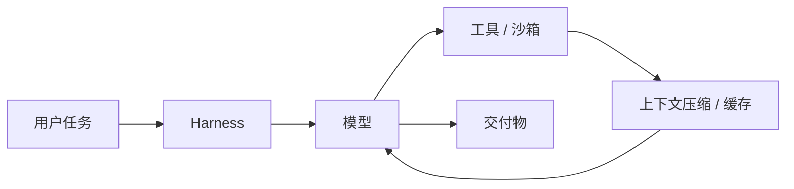

GPT-6 的 ARC-AGI-3 98.6% 不是裸模型跑出来的，是 Responses API 跑出来的。据 [InfoQ 报道](https://www.infoq.cn/article/mKGb7ZiPRlAiFDZCWK0v)，OpenAI 自己说，这些系统选择可以在不改底层模型的情况下把分数拉高。换句话说，榜单上的“模型能力”，有一部分属于 harness：怎么保留回合间推理、怎么压缩上下文、怎么调工具、怎么重试。

这篇不谈参数，谈模型外面那层壳。读者是正在做选型或 Agent 平台的人。

图 1：harness 把模型、工具、上下文串成一个闭环。

## 分数是模型加壳一起跑出来的

同一个模型，换 harness，分数会变。

GPT-6 的 ARC-AGI-3 是在 Responses API 框架下跑的：保留回合间推理，用压缩管理长上下文。OpenAI 明确说，系统选择本身就能提高分数。

Claude 的 Terminal-Bench 成绩绑定 Claude Code；Gemini 的 Agent 能力绑定 Antigravity；Kimi 的代码分数绑定自己的 Agent 框架。榜单不会告诉你这些，但复现的人一跑就知道。

这不是作弊，是能力交付的形态变了。模型不再是 API 里一个孤立的 completion，而是“模型 + 工具 + 上下文管理 + 权限”的运行时。

## 上下文压缩：把窗口变成工作记忆

1M 窗口听起来很大，但 Agent 跑几小时就塞满。真正决定能不能持续工作的，是压缩策略。

Claude 的做法比较完整（见 [上下文窗口文档](https://platform.claude.com/docs/zh-CN/build-with-claude/context-windows)）：

- **服务端压缩**：自动总结对话早期部分，让会话突破窗口限制；
- **上下文感知**：API 在系统提示里注入 token 预算，模型知道还剩多少，可以主动收尾；
- **思考块清除**：旧轮次的 thinking block 可以清掉，释放窗口；
- **工具搜索**：工具定义延迟加载，避免几十个 MCP 工具塞满上下文。

GPT-6 的 Responses API 则保留回合间推理，并用压缩管理长上下文。Gemini 4 把输入输出放进同一个 1M 预算，长解码用 continuation protocol 续写。

三种做法不同，目标一致：把“窗口”变成“可管理的工作记忆”。窗口是容量，压缩是策略；只有容量没有策略，Agent 跑到第三十分钟就会开始忘事。

## effort：同一套权重，不同价位

Claude Opus 5.5 的自适应思考始终开启，effort 可调，默认 medium；Fable 5.1 默认 high（见 [Opus 5.5 文档](https://platform.claude.com/docs/zh-CN/models/opus-5-5/overview)）。GPT-6 在 Chat 里给 Instant、Medium、High、XHigh 四档，Pro 档换成 Astra。Kimi K3.1 Pro 给 Low、High、Max 三档。

这不是 UI 花活，是定价工具。低档便宜快，高档贵慢；厂商用同一套权重覆盖不同预算的客户，比训练多个尺寸经济。

对使用方来说，关键指标不是每百万 token 单价，是**每任务美元**。Claude 说 Opus 5.5 比 Opus 5 在典型任务上便宜 40%，靠的是更少 token 加更少算力，而不只是单价降了 20%。

## 安全也在壳里

模型层的安全不够，因为 Agent 会动手。

Claude Opus 5.5 在每个动作执行前过分类器，提供可审计的开源沙箱，代码审查在合并前拦漏洞。Gemini 4 Argon 在 Antigravity 里给隔离 Linux 沙箱，自动 misalignment 监控读取 Agent 的推理和动作，实时阻断“遇到权限错误就绕路”。

prompt injection 的数字更能说明问题：Gemini 4 Argon 在 Gray Swan 间接注入基准上，15 次自适应攻击的成功率是 0.7%；[Carbon](https://blog.google/innovation-and-ai/models-and-research/gemini-models/introducing-gemini-4-carbon/) 降到 0.0%。Claude 说 Opus 5.5 与 Fable 5.1 并列最低。

这些能力不全是模型权重带来的，很多是 harness 层的分类器、沙箱、监控。买模型不带这些，等于买发动机不买刹车。

## 选型时该测什么

- **用你自己的 harness 测**，不要直接抄榜单。同一模型换框架，分数会变。
- **算每任务成本**：token、缓存命中、重试、人工复核，全算进去。
- **看缓存设计**：Claude 的缓存读价是输入价的 5%，Gemini 缓存输入打 95% 折扣；Agent 多轮对话里前缀重复占大头，缓存策略直接决定毛利。
- **别默认开最高档**：简单任务用低 effort，复杂任务才开 Max；先做路由，再谈模型。
- **1M 不等于能塞**：先测召回，再决定是否把整个代码库放进去。

模型是发动机，harness 是变速箱；只比马力，买车一定买错。
